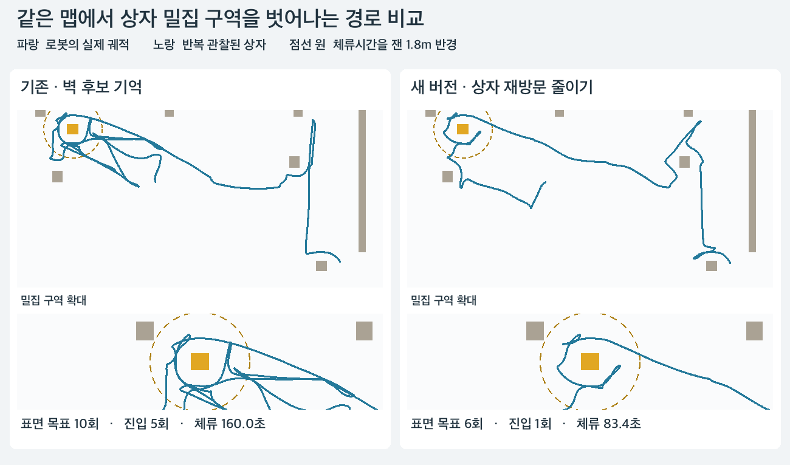

# 같은 상자 밀집 맵에서 재방문 억제판 비교

Gazebo 4번 맵 `fuAePeEx`를 각 정책으로 한 번씩 돌렸다. 시뮬 월드, 마커와 상자 배치, 초기 위치와 방향이 일치했다. 기존 벽 후보 기억판과 새 실험판은 모두 마커 7·32·103을 각각 등록하고 실제로 1.5m 이내에 접근했다.

| 지표 | 작은 벽 후보 기억 | 상자 재방문 줄이기 |
|---|---:|---:|
| 반복 관찰된 서쪽 상자를 향한 표면 목표 | 10회 | 6회 |
| 해당 상자 주변 진입 (첫 진입 포함) | 5회 | 1회 |
| 해당 상자 중심 1.8m 안 체류 | 160.0초 | 83.4초 |
| 103번 접근 시각 | 70.2초 | 67.7초 |
| 7번 접근 시각 | 414.9초 | 244.4초 |
| 32번 접근 시각 및 완주 시간 | 481.5초 | 339.7초 |
| 범퍼 이벤트 | 0회 | 0회 |

기존판은 같은 서쪽 상자를 향해 목표를 보냈다가 다른 탐색 목표를 찍고 다시 돌아왔다. 9·10번은 피팅된 개별 면이었고, 이후 11·13·15·17번에서는 다시 같은 상자에 속한 격자 표면을 선택했다. 목표 13·15에서는 한 번 미뤘던 표면 후보를 다시 사용할 수 있었다. 기존 선택기는 45초의 면별 재시도 대기만 지난 경우와 로봇이 이 상자의 주변을 충분히 봤는지를 따로 다뤘다.

새 버전의 11·12번째 목표(145.2초, 172.2초)는 반복 구역 밖의 탐색 지점이었다. 13번째 목표에서 다른 상자의 표면을 선택했다. 이후 서쪽 상자에는 다시 들어가지 않았다. 남쪽 상자 주변 체류 시간은 19.2초에서 43.0초로 늘었다. 특정 구역의 반복을 줄였다는 결과가 모든 상자의 관찰 시간이 줄었다는 뜻은 아니다.

평가에서는 각 표면 목표를 그 시점의 SLAM 자세로 Gazebo 좌표에 옮긴 뒤 가장 가까운 실제 상자 중심에서 0.60m 안인 목표를 집계했다. 진입은 1.8m 안으로 들어왔을 때 기록하고, 2.1m 밖으로 나간 뒤 다시 들어와야 한 번 더 센다. 주행 정책에는 Gazebo의 상자 위치를 제공하지 않았다. 1.8m 반경은 진입·체류 집계에 쓰며 마커 접근 기준은 1.5m다. 두 주행은 처음 상자를 본 순서도 달랐다. 이 결과만으로 평균 단축 시간을 추정할 수는 없다.

