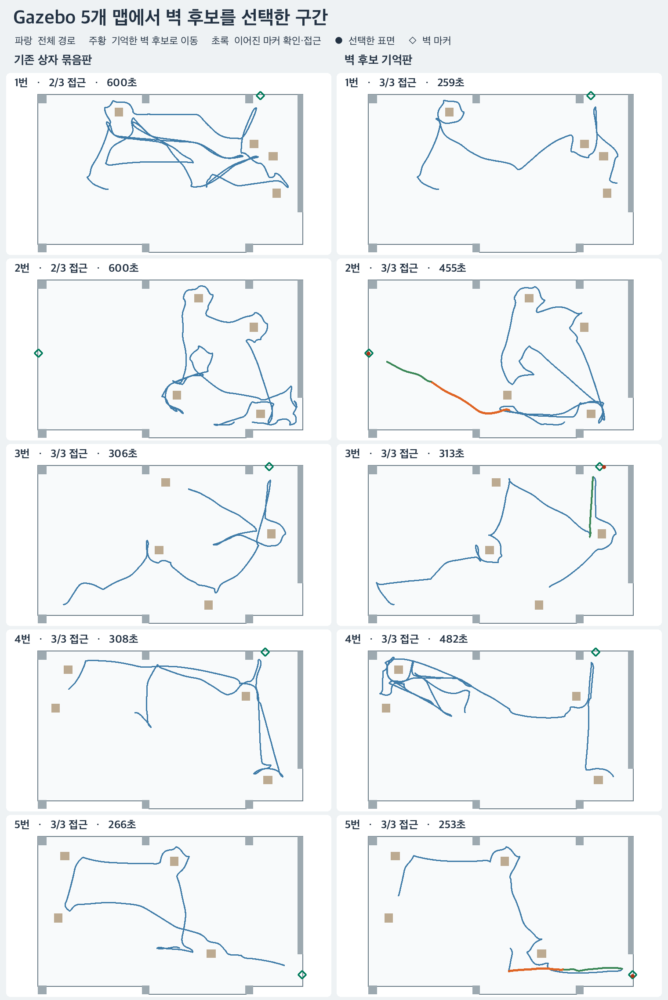
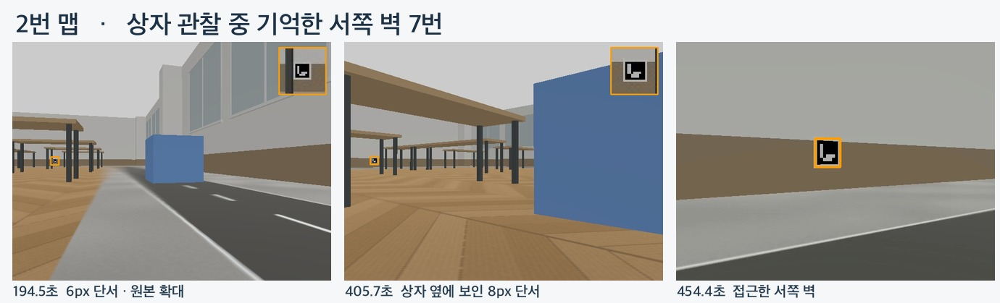

# 작은 벽 후보 기억판과 상자 묶음판의 다섯 맵 비교

각 맵의 Gazebo 월드 해시, 마커 배치, 출발 위치(3cm 이내)와 방향(1도 이내)을 대조했다. 각 정책을 맵당 1회 실행했다. 제한은 시뮬 시간 600초이고, 완주는 ID 7·32·103이 각각 등록된 상태에서 로봇이 해당 마커 중심 1.5m 안에 실제로 들어가는 것으로 계산했다.

| 지표 | 상자 묶음 | 벽 후보 기억 |
|---|---:|---:|
| 완주 | 3/5 | 5/5 |
| 등록 후 1.5m 접근 | 13/15 | 15/15 |
| 벽 마커 접근 | 4/5 | 5/5 |
| 평균 소요 시간 (시간 초과 포함) | 416.1초 | 352.4초 |
| 범퍼 이벤트 | 0 | 0 |

| 맵 | 상자 묶음 접근 및 시간 | 벽 후보 기억 접근 및 시간 | 기억한 벽 목표 선택 | 잘못된 시각 목표 점유 시간 (기존 → 기억판) |
|---|---|---|---|---|
| 1 · `VDiWOjnw` | 2/3 · 600.0초 | 3/3 · 259.4초 | 없음 | 0.0 → 0.0초 |
| 2 · `spjbfI5O` | 2/3 · 600.0초 | 3/3 · 455.5초 | 406.7초 (상자 관찰 후) | 0.0 → 0.0초 |
| 3 · `wK13S60d` | 3/3 · 306.5초 | 3/3 · 313.0초 | 210.2초 (상자 관찰 후) | 0.0 → 0.0초 |
| 4 · `fuAePeEx` | 3/3 · 307.6초 | 3/3 · 481.5초 | 없음 | 0.0 → 0.0초 |
| 5 · `7MgfZqWs` | 3/3 · 266.3초 | 3/3 · 252.5초 | 15.8초 (상자 관찰 전) | 0.0 → 0.0초 |

## 기억한 방향으로 실제 주행했는가

- 2번 맵의 24번째 목표. 첫 영상 단서 35.1초, 목표 선택 406.7초. 앞서 실제로 면을 확인한 상자 목표는 9개였다. 이 벽을 지지한 서로 다른 영상 시각 49개 중 34개는 상자 관찰 목표가 진행 중일 때 기록됐다. 선택한 표면과 벽 마커 7의 위치 차이는 0.04m였다. 벽 후보 선택 시 거리는 11.52m, 이 목표 자체를 따라간 구간의 최소 거리는 5.165m, 연속된 동일 마커 확인·접근 목표까지 포함한 최소 거리는 1.496m였다. 등록 후 1.5m 안에 들어온 시각은 455.5초였다.
- 3번 맵의 13번째 목표. 첫 영상 단서 137.4초, 목표 선택 210.2초. 앞서 실제로 면을 확인한 상자 목표는 2개였다. 이 벽을 지지한 서로 다른 영상 시각 12개 중 0개는 상자 관찰 목표가 진행 중일 때 기록됐다. 선택한 표면과 벽 마커 32의 위치 차이는 0.34m였다. 벽 후보 선택 시 거리는 5.39m, 이 목표 자체를 따라간 구간의 최소 거리는 5.390m, 연속된 동일 마커 확인·접근 목표까지 포함한 최소 거리는 0.907m였다. 등록 후 1.5m 안에 들어온 시각은 227.4초였다.
- 5번 맵의 2번째 목표. 첫 영상 단서 13.6초, 목표 선택 15.8초. 앞서 실제로 면을 확인한 상자 목표는 0개였다. 이 벽을 지지한 서로 다른 영상 시각 11개 중 0개는 상자 관찰 목표가 진행 중일 때 기록됐다. 선택한 표면과 벽 마커 7의 위치 차이는 0.12m였다. 벽 후보 선택 시 거리는 9.42m, 이 목표 자체를 따라간 구간의 최소 거리는 5.241m, 연속된 동일 마커 확인·접근 목표까지 포함한 최소 거리는 0.883m였다. 등록 후 1.5m 안에 들어온 시각은 53.7초였다.

3번 맵에서는 외부 기록기가 32번 등록을 210.172초에 수신했고, 벽 후보 목표를 보낸 시각은 210.180초였다. 목표를 고른 내부 상태에는 아직 7번만 있었다. 이 사례에서 약한 단서가 먼저 ID 발견을 유도했다고 보기 어렵다. 벽 후보 목표 자체가 1초 뒤 기존 마커 추적으로 바뀌었다.

## 오탐 비용과 해석

- 상자 묶음에서 기억한 벽 목표를 0회 선택했고, 실제 벽 마커에서 0.5m를 벗어난 목표는 0회, 점유 시간은 0.0초였다. 기존 근접 확인(focus) 목표는 4회였고, 잘못된 ID·위치로 간 횟수는 0회였다.
- 벽 후보 기억에서 기억한 벽 목표를 3회 선택했고, 실제 벽 마커에서 0.5m를 벗어난 목표는 0회, 점유 시간은 0.0초였다. 기존 근접 확인(focus) 목표는 2회였고, 잘못된 ID·위치로 간 횟수는 0회였다.

오탐 시간은 잘못된 시각 목표를 보낸 때부터 다음 목표 또는 종료까지의 시뮬 시간이다. 일반 탐색 중 잠시 다른 곳을 보거나 영상에만 나타난 후보는 집계 대상 밖이다. 시뮬 정답은 평가에만 사용했다. 각 목표 시점의 지도 자세와 세계 좌표를 맞춰 같은 벽 마커의 정답 위치와 대조했다. 벽 후보의 표면 오차 판정(0.5m)과 로봇 자체가 접근했는지의 판정(1.5m)은 별도로 계산했다.

상자 우선순위는 당장 확인했고 갈 수 있는 면에 적용된다. 아직 발견하지 않은 상자가 있는 상태에서도 벽 후보로 먼저 갈 수 있다. 1번 맵은 벽 후보 선택 없이도 새 주행이 완주했다. 이 맵의 결과 차이까지 기억 기능의 효과로 돌릴 근거는 없다. 5개 장면에서 각각 한 번씩 얻은 수치이며 실물 성능은 별도 검증이 필요하다.

