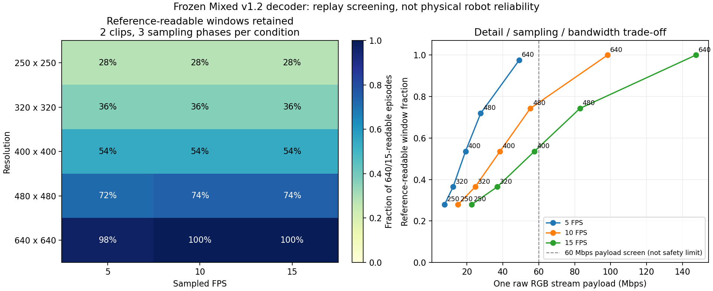

# Frozen Mixed v1.2 — 해상도·FPS 비교

실물 첫 시험은 **480×480·5FPS**를 권한다. 스쳐가는 장면은 **480×480·10FPS**, 먼 마커 판독은 **640×640·5FPS**를 추가 후보로 남긴다. 실물에서 검증한 최적값이나 다운되지 않는다는 보장은 아니다. 로봇 설정과 주행 정책은 변경하지 않았다.

## 비교 범위

- 250·320·400·480·640 정사각형 × 5·10·15FPS, 총 **15조합**.
- 서로 다른 맵의 640×640·15FPS 기준 영상 두 개를 축소하고 FPS 위상 세 개를 적용한 **90개 파생 재생 조건**. 90개의 독립 주행이 아니다.
- 새 Gazebo 실행 **16회**: 기준 영상 2회(각 45초), 폐루프 주행 검증 14회(최대 90초). 한 번에 하나만 실행했다.
- 14회는 두 맵 × 네 기본 설정 8회, 480·5/10FPS의 첫 맵 추가 반복 4회, 두 번째 맵 400·10/480·15FPS 각 1회다. 반복 수가 균등하지 않고 다양한 실물 환경을 대표하지 않는다.
- v1.2 원본과 실험 스테이지의 소스·설정 **219파일 SHA-256 일치**. 센서 생성 모듈의 영상 크기·FPS만 별도 스테이지에서 바꿨다. 생성된 15조건 검사 통과, LiDAR 10Hz·IMU 100Hz 유지.
- v1.2 전진 상한 0.25m/s, smoother 0.27m/s, 회전 상한 0.5rad/s 유지. Footprint·충돌 검사·장애물 여유 유지.
- 맵별 world SHA가 동일하고 출발 위치 오차 최대 약 1.6mm, 회전 오차는 소수점 4자리에서 0rad였다. 관측 이후 경로는 달라질 수 있다. 정답 좌표는 평가기만 사용한다.
- launch의 namespace 선언이 누락됐던 초기 실패는 수정 후 재실행했으며 아래 카메라 결과에서 제외했다. 카메라 과부하로 판정하지 않았다.

## 폐루프 결과

성공은 **세 ID 등록 + 등록 뒤 각 마커까지 독립 실제 거리 ≤1.5m**다. 평가기는 이 조건에서 종료한다. 정책의 더 엄격한 근거리 판독 증거·종료, 지도 좌표 정확도, 10분 완주를 검증한 결과는 아니다. 일부 상자 ID는 mission 시작 전에 이미 등록됐으며 회차별 초기 ID를 저장했다.

| 정사각형 RGB | FPS | 위 조건 충족 | 평균 시뮬 초¹ | 평균 실제 초¹ | RGB 순수 전송량² | 영상 heartbeat 지연 p95 최대³ |
|---|---:|---:|---:|---:|---:|---:|
| 250×250 | 10 | 1/2 | 84.0 | 92.7 | 15.0Mbps | 48ms |
| 400×400 | 10 | 1/1 | 72.7 | 83.4 | 38.4Mbps | 60ms |
| 480×480 | 5 | 3/4 | 66.3 | 71.0 | 27.6Mbps | 76ms |
| 480×480 | 10 | 3/4 | 61.3 | 69.1 | 55.3Mbps | 72ms |
| 480×480 | 15 | 1/1 | 47.5 | 64.9 | 82.9Mbps | 68ms |
| 640×640 | 5 | 2/2 | 63.3 | 73.3 | 49.2Mbps | 100ms |

¹ 미충족 회차의 90초도 포함한 제한 시간 내 관측 평균이다. 성공 회차만의 평균이나 진정한 기대 완주 시간이 아니다. 실제 초는 launch·초기화 시간을 제외한 mission 구간이다.
² BGR8 한 스트림 `width × height × 3 × FPS × 8`, 압축·DDS 부가량·여러 구독자·추가 토픽 제외. **480×480은 640×480인 480p와 다르다.**
³ 시뮬 시각 기준 촬영 timestamp→detector heartbeat 수신까지다. ID 최종 등록 지연이나 센서 전체 지연이 아니다.

14회 모두 범퍼 0회, 정책의 센서 중단 0회였다. 모든 조건에서 요청한 시뮬 FPS를 처리했다. Nav2 control-loop 주기 초과 경고는 회차별 0–11회였으며, CPU 여유와 무관한 완전한 제어 안정성을 보장하지 않는다.

480·5FPS와 480·10FPS 모두 4회 중 3회 조건을 충족했다. 같은 첫 맵에서 각각 한 번씩 90초 제한에 걸렸다. 640·5FPS는 2/2였지만 표본이 작다. 따라서 640·5FPS가 전체 주행 최적이라고 확정하거나 5FPS가 10FPS보다 안정적이라고 단정할 수 없다.

480·15FPS는 시뮬 47.5초였으나 실제 64.9초, 실시간 대비 0.73배였다. 한 번의 결과로 고FPS를 우승으로 고르지 않는다. 주행 경로·정책 이벤트·호스트 부하가 함께 영향을 줄 수 있다.

## 판독과 FPS의 교환관계

이 그림은 640·15FPS에서 판독 가능한 연속 구간마다 축소·샘플링 후 **18픽셀 이상 판독 프레임이 최소 한 개 남았는지**를 측정한다. 진짜 마커가 화면에 보인 모든 구간의 recall이나 최종 등록 성공률이 아니다. 두 영상·위상 평균은 250·10 약 28%, 480·5 약 72%, 480·10 약 74%, 640·5 약 98%였다. 이 영상에서는 작은 픽셀 수가 더 큰 제약이었다.

예상하지 않은 ID는 기준 두 영상의 재생에서 0프레임이었다. 현실의 오탐률·엉뚱한 회전 횟수를 입증하지 않는다. 디코더 p95는 480 약 3.7–3.8ms, 640 약 6.0–6.1ms로, ROS/TF/거리/등록 합의·정책 계산을 제외한 시간이다.

FPS는 노출 시간을 자동으로 줄이지 않는다. 0.2초 스침이라면 5FPS의 약 1장보다 10FPS의 약 2장이 유리할 수 있지만, 흐린 프레임·카메라 실제 송신률·드롭·판독 크기가 남아 있다. 이번에는 빠른 회전이나 motion blur를 모델링하지 않았다.

## 로봇 다운 위험을 여기서 확정할 수 없는 이유

실험은 MacBook Air M5·24GB 위 6vCPU/약 10GiB Ubuntu VM, ROS loopback 전송이다. RPi/OAK-D의 실제 ISP·USB·메모리·네트워크와 Create3 DDS 처리는 포함하지 않는다. Gazebo 렌더 비용은 실물 카메라 부하와 다르다.

이전 실물 bag은 250×250·약 10FPS였다. 그 CameraInfo로 계산한 명목 수평 화각은 약 64.2°, 이번 Gazebo는 약 71.6°다. 따라서 실제 인식 거리와 시야 통과 시간을 그대로 예측할 수 없다. 실물 최근 측정값이 아니라 보존 영상의 설정이다.

detector CPU 중앙값은 조건별 약 한 코어의 21–35%, 표본 RSS 최대 약 218MiB였다. 이는 Mac VM 프로세스 값이며, RPi 전체 메모리나 Create3 자원 사용률이 아니다. 전체 메모리 누수·긴 시간 안정성을 확인할 만큼 길게 돌리지도 않았다.

## 실물 적용 전 선택 순서

1. **480×480·5FPS**: 27.6Mbps. 우선 화질을 올리되 10FPS 후보의 절반 전송량으로 시작하는 안이다.
2. **480×480·10FPS**: 55.3Mbps. 실물 영상·제어 지연이 안정적일 때 스쳐가는 장면을 더 촘촘히 받는 안이다.
3. **640×640·5FPS**: 49.2Mbps. 먼 마커 판독을 중시할 때 비교한다. 480·10보다 순수 전송량은 적지만 프레임당 처리량과 순간 DDS 패킷은 커진다.
4. 400×400·10FPS는 38.4Mbps의 중간안이지만 이번 재생에서 먼 판독 구간을 더 놓쳐 우선 3안에서 제외했다. 480·15FPS는 82.9Mbps로 실물 첫 설정에 권하지 않는다.

OAK-D가 해당 preview 크기·CameraInfo를 지원하는지 먼저 확인한다. 정지 상태에서 기존 250·10과 각 후보를 같은 시간 비교하고, RGB 입력/처리 FPS·원본 timestamp의 p95/p99 age·/scan·/odom·hazard 갱신·TF 실패·Create3 응답·RPi CPU/RAM/온도·Mac VM 자원을 함께 기록해야 한다. 입력 FPS만 정상이어도 제어 토픽이 늦어지면 탈락이다. 짧은 카메라 시험을 통과한 뒤 기존 속도에서 회전과 근거리 주행을 비교한다. 끊김·RSS 지속 증가·제어 응답 악화 시 기존 설정으로 복귀하며 충돌 검사는 그대로 둔다.

실물 설정 변경과 주행은 이번 실험에 포함하지 않았다. 후보는 [profiles.json](profiles.json)에만 저장했다.

## 재현과 자료

- `install.py`로 보존 v1.2에서 새 스테이지 생성. `suite_runner.sh`에 실제 VM 경로·별도 domain·lock 설정이 있다. `initial` 완료 뒤 `followup` 실행. 원본 스테이지는 수정하지 않는다.
- [14회 상세 결과](comparison.json), [집계](aggregate.json), [15조합 선정](screening.json), [영상1 재생](replay-map-1.json), [영상2 재생](replay-map-2.json), [소스 해시](source_integrity.json), [실물 보존 CameraInfo](real_camera_reference.json).
- VM 결과: `/home/ubuntu/camera-v12-expanded-1120`, 원본 영상/센서 기록: `/home/ubuntu/corridor-board-73bbb05/recordings/v12-*expanded1120*`.
- 시뮬 보드: `http://192.168.252.2:8780/`, 카드 이름 `v12-validation-*`, `v12-repeat-*`, `v12-intermediate-*`, `v12-high-fps-*`.
- 완성 MP4 16개는 Mac `vm_runs/v12-camera-benchmark-20261121/`에 보존했다. [영상 해시·프레임 검증](video_index.json). MP4는 timestamp 기준 5FPS로 재표본화한 시청용 영상이며, 분석은 원래 수신 프레임을 사용했다. 최종 평가 메타데이터는 `/private/tmp/camera-v12-export1121/`에도 있다. 소유자 승인 후 16개 모두 공개 Release 업로드·크기·SHA-256을 검증했다. [공개 영상 목록](videos.md).
