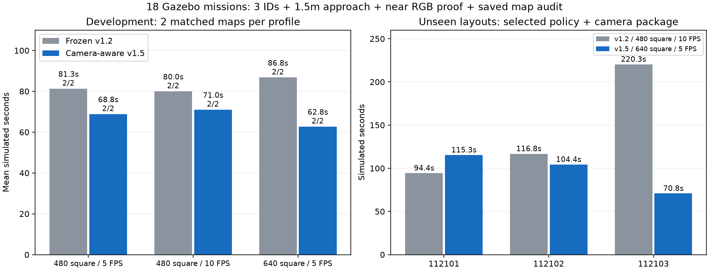
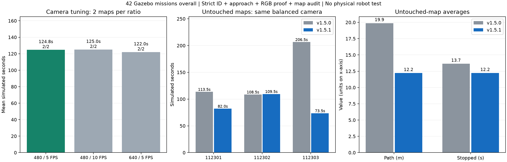

# Mixed 카메라 정책 · 수정과 순차 Gazebo 검증

최종 검증까지 완료했다. 아래 결과는 시험한 Gazebo 조건의 비교이며 전역 최적성이나 실물 안정성을 증명하지 않는다.

새 native 주행 **42회**, 서로 다른 world **11개**, 회귀 검사 **44개**. 카메라의 이전 15조합·90개 파생 재생·16회 Gazebo 시험은 [별도 기록](../2026-11-20_v12_camera_rate/README.md)이며 이 수에 합산하지 않는다.

전체 엄격 통과는 **41/42회**, 범퍼는 **0회**다. 버전과 선정 단계별 결과를 아래에 분리했다.

## 무엇을 바꿨나

| 버전 | 변경 | 보존한 기준 |
|---|---|---|
| v1.2 | 기존판. 480·5 / 480·10 / 640·5 프로필을 각각 보존 | 원본 기준 |
| v1.5.0 | TF가 준비된 최신 노출 선택, ID별 예외 분리, 처리 끝 heartbeat, 일관된 광학 기하, 시간 기반 다중 시점 기억 | Nav2·속도·18px·세 프레임·1.3m 근거리 증거 |
| v1.5.1 | 촬영 시각 scan/depth 선택, 다른 노출 시각 사이의 이동 보정 | 원래 센서 시간 차이 한도와 모든 주행 설정 |
| v1.6.0 | 실제 실행 때 focus 예산 차감, 가까운 안전한 새 면 하나의 제한적 우선 관찰 | 확인 마커 접근·안전 복구와 기존 경로 필터 |

[검토한 코드와 근거](../../policy_candidates/2026-11-21_mixed_camera_aware/REVIEW.md) · [동기화판](../../policy_candidates/2026-11-21_mixed_exposure_sync/README.md) · [상자 우선 조정판](../../policy_candidates/2026-11-21_mixed_local_commitment/README.md)

## 평가 기준

세 ID 등록, 등록 후 독립 거리 각각 ≤1.5m, 기존 정책의 세 장 ≤1.3m 근거리 영상 증거, 초기 map↔실제 좌표 정렬을 고정한 지도 위치 오차 ≤0.25m, 범퍼 0회를 모두 요구한다. 종료 뒤 저장된 지도 좌표를 다시 검사한다. 정답은 평가기에만 있고 정책에 제공하지 않는다.

동일 world·출발점·속도·안전 여유를 쓰며 한 번에 한 Gazebo만 실행한다. domain 174·loopback과 공통 두 lock으로 실물 domain 4 및 다른 시뮬과 분리한다. 모든 전진 상한은 MPPI 0.25m/s·smoother 0.27m/s, 회전 상한 0.5rad/s이다.

## 1차 · 세 카메라 프로필과 새 배치

개발 112021·112022에서 6버전 × 2맵 = 12회(각 최대 180초). 개발 데이터만으로 v1.2는 glance, v1.5.0은 detail을 선택했다. 이후 112101·112102·112103에서 두 선택 패키지를 각 1회(최대 300초) 평가했다.

| 구간 | 버전·프로필 | 엄격 성공 | 평균 시뮬 초¹ | 평균 실제 초¹ | 거리 m | 정지 초² |
|---|---|---:|---:|---:|---:|---:|
| development | v1.2 balanced | 2/2 | 81.3 | 81.4 | 11.7 | 7.3 |
| development | v1.2 glance | 2/2 | 80.0 | 80.1 | 11.3 | 8.8 |
| development | v1.2 detail | 2/2 | 86.8 | 86.9 | 12.7 | 7.7 |
| development | v1.5.0 balanced | 2/2 | 68.8 | 69.3 | 10.7 | 6.0 |
| development | v1.5.0 glance | 2/2 | 71.0 | 71.4 | 10.6 | 6.5 |
| development | v1.5.0 detail | 2/2 | 62.8 | 62.9 | 8.4 | 5.8 |
| held_out | v1.2 glance | 3/3 | 143.8 | 144.0 | 19.9 | 16.7 |
| held_out | v1.5.0 detail | 3/3 | 96.8 | 97.0 | 12.9 | 9.5 |

평가 맵 평균은 143.8→96.8초였지만 112101에서는 94.4→115.3초로 악화됐다. 선정된 카메라 설정도 다르므로 이 3맵 평균을 알고리즘 하나의 인과 효과로 해석하지 않는다.

악화 회차의 실제 목표 순서는 미완료 상자 관찰 중 벽 7번 focus → 벽 접근 → 상자 재방문이었다. `PhasedHybrid.select`는 focus/approach를 상자 스케줄보다 먼저 반환한다. 그 우회 규칙과 실제 경로는 확인했지만, 전체 21초 차이를 그 한 원인에만 귀속하지 않는다.

## 2차 · 센서 동기화와 상자 관찰을 분리

모두 640×640·5FPS로 고정했다. 112021과 1차 반례 112101은 명시적으로 개발 자료다. v1.5.0 / v1.5.1 / v1.6.0을 각각 재실행했다. 새 112201·112202·112203에는 위치 변동과 마커 없는 원통 방해물도 추가했다.

| 구간 | 버전·프로필 | 엄격 성공 | 평균 시뮬 초¹ | 평균 실제 초¹ | 거리 m | 정지 초² |
|---|---|---:|---:|---:|---:|---:|
| development | v1.5.0 detail | 1/2 | 133.0 | 133.1 | 17.4 | 14.2 |
| development | v1.6.0 detail | 2/2 | 93.3 | 93.3 | 13.2 | 8.4 |
| development | v1.5.1 detail | 2/2 | 83.9 | 84.0 | 11.8 | 9.6 |
| held_out | v1.5.0 detail | 3/3 | 123.3 | 123.6 | 16.0 | 15.1 |
| held_out | v1.5.1 detail | 3/3 | 118.0 | 118.2 | 13.9 | 17.0 |

개발 결과만으로 **v1.5.1 detail**을 선택했다. 성공·접촉·센서 중단을 먼저 보고, 동등하면 상자 우선 조정이 평균 시간을 최소 5% 개선할 때만 더 복잡한 판을 선택하는 기준이었다.

v1.6.0의 두 개발 회차에는 한 면 추가 관찰 dispatch 기록이 없었다. 따라서 그 동작이 주행에서 효과를 냈다고 주장하지 않는다. 제안/실행 예산 분리의 콜백 검사는 통과했다.

미달 회차 `v15-camera-detail-m112101-dev2`는 180.0초 공통 제한까지 ID [7, 103]만 등록했고, 32번 등록·접근을 완료하지 못했다. 정책 실패로 집계하고 원본 영상도 보존했다. 인프라 오류로 제외하거나 성공할 때까지 재시도하지 않았다.

## 선택 알고리즘의 카메라 비율 재검증

알고리즘이 바뀌면 적절한 카메라도 달라질 수 있어 세 비율을 다시 비교했다. 112201·112202는 이 단계에서 카메라 선정 자료로 재사용했다. 모두 시뮬 12초까지 같은 사전 관측 시간을 주고, 마지막 112301~112303 결과를 보기 전에 설정을 고정했다.

| 구간 | 버전·프로필 | 엄격 성공 | 평균 시뮬 초¹ | 평균 실제 초¹ | 거리 m | 정지 초² |
|---|---|---:|---:|---:|---:|---:|
| development | v1.5.1 balanced | 2/2 | 124.8 | 125.0 | 16.3 | 14.0 |
| development | v1.5.1 glance | 2/2 | 125.0 | 125.5 | 17.3 | 15.0 |
| development | v1.5.1 detail | 2/2 | 122.0 | 122.4 | 15.2 | 16.6 |

선정 프로필: **balanced**. 성공·접촉·센서 중단이 동등한 조합 중 최고 평균 시간의 5% 이내인 조합은 RGB payload가 적은 것을 선택했다. 이 5%는 비교 전에 정한 실용적 허용폭이며 실물 안전 임계값이 아니다.

| 프로필 | 유효 처리 FPS 최저 | 처리 영상 age p95 최대 | 검출기 CPU 중앙값 평균¹ | 검출기 RSS 최대 |
|---|---:|---:|---:|---:|
| balanced | 5.0 | 52ms | 24.0% | 200.2MiB |
| glance | 10.0 | 52ms | 29.5% | 203.7MiB |
| detail | 5.0 | 64ms | 27.0% | 222.4MiB |

¹ VM에서 한 코어를 100%로 잡은 프로세스 값이다. RPi나 Create3의 자원 사용량이 아니다.

## 마지막 검증 · 같은 초기 관측 시간과 새 세 맵

선정 뒤 코드를 바꾸지 않고 112301·112302·112303에서 비교했다. 양쪽 모두 같은 480×480·5FPS, 시뮬 시각 12초까지 정지 관측 후 시작하도록 평가기만 통제했다. 이 warmup은 일반 실행 쉘이나 실물 시작 절차에 추가하지 않았다.

| 구간 | 버전·프로필 | 엄격 성공 | 평균 시뮬 초¹ | 평균 실제 초¹ | 거리 m | 정지 초² |
|---|---|---:|---:|---:|---:|---:|
| held_out | v1.5.0 balanced | 3/3 | 142.8 | 143.1 | 19.9 | 13.7 |
| held_out | v1.5.1 balanced | 3/3 | 88.3 | 88.4 | 12.2 | 12.2 |

| 맵 | 버전 | 초기 등록 ID | 결과 | 시간 |
|---|---|---|---|---:|
| 112301 | v1.5.0 | [] | 통과 | 113.5s |
| 112301 | v1.5.1 | [] | 통과 | 82.0s |
| 112302 | v1.5.1 | [103] | 통과 | 109.5s |
| 112302 | v1.5.0 | [103] | 통과 | 108.5s |
| 112303 | v1.5.0 | [] | 통과 | 206.5s |
| 112303 | v1.5.1 | [] | 통과 | 73.5s |

최종 비교: v1.5.0 3/3회, v1.5.1 3/3회 통과. 평균 시간 142.8→88.3초, 거리 19.9→12.2m, 최종 선정판의 저장 지도 오차 최대 4.7cm. 맵당 한 회씩이며 통계적으로 모든 환경에서 우월하다는 결론은 내리지 않는다.

112302에서는 선정판도 `navigation_stalled` 취소가 한 번 발생한 뒤 복귀해 109.5초에 끝났고, 기준판의 108.5초보다 약 1초 느렸다. 112303의 기준판은 interior_surface 선택 10회·29.1m였고 선정판은 4회·10.8m였다. 이 로그는 불필요한 이동 차이를 보여 주지만, 모든 시간 이득을 센서 동기화 하나의 인과 효과로 분리한 반복 실험은 아니다. 선정판에서도 거리 없음 판정과 경로 정체 가능성이 완전히 사라진 것은 아니다.

¹ 제한 시간에 걸린 회차의 경과도 평균에 포함한다. 성공한 회차만의 시간이나 진정한 기대 완주 시간이 아니다. 실제 초는 mission 구간이며 launch·warmup은 제외한다.
² 독립 위치·yaw로 제자리 회전과 정지를 구분했다. 위치 변화가 작은 모든 시간을 낭비라고 부르지 않는다.

## 처리 지연 반례와 검증

- 120ms TF 지연: v1.2는 ID42를 37프레임 판독하고도 등록하지 못했다. v1.5.0은 같은 합성 조건에서 등록·오류 0회.
- 250ms TF 지연: v1.5.0도 영상 대기 중 깊이가 최신 프레임으로 바뀌어 거리 없음 37회·등록 0개였다. 촬영 시각에 맞춘 v1.5.1과 동일한 perception 코드는 ID42를 등록·오류 0회로 처리했다.
- 입력·TF·범위 센서가 모두 정상인 Gazebo 주행과 위 합성 ROS 지연 시험은 별개다. 합성 시험을 주행 완주 횟수에 더하지 않는다.
- 44개 검사에는 이동 중 5FPS 시점, 60초 기억, 불량 ID와 이웃 ID, 기존 검출, 15개 센서 조건, 시각 정합, 이동 보정, 제안/dispatch 예산, 시간 초과와 안전 복구 우선순위, 실제 Mission 생성이 포함된다.

## 별도 보드 표시 결함

새 원통 방해물의 scene에는 `radius`만 있는데, 실행 보드의 `scene_geometry`는 모든 장애물에서 `sx/sy`를 읽어 `/api/runs` 전체가 KeyError로 끊겼다. 표시 전용 정규화에서 원통 반지름을 보존하고 실제 원으로 그리도록 수정했다. 잘못된 단일 표시 항목도 나머지 목록을 중단시키지 않는다. 별도 표시 검사 2개 통과, 원통이 있는 장면을 포함한 API HTTP 200 응답을 확인했다. 8780 HTTP 서버만 재시작했으며 ROS·Gazebo·주행 정책은 그대로 실행했다. 원본 백업과 재현 설치는 `patch_sim_board.py`에 있다.

## 한계와 자료

- 표본은 8×6m의 작은 정적 공간과 고정 크기 세 마커다. 새 seed·방향·방해물을 바꿔도 모든 환경의 최적성을 입증하지 않는다. 경로는 MPPI·관측 시점에 따라 달라질 수 있다.
- 앞선 두 비교는 mission 시작 전부터 검출하며 초기 ID가 다를 수 있다. 이를 저장했고 마지막 검증에서 관측 시간도 같게 맞췄다.
- 해상도는 정사각형 RGB, BGR8 한 스트림 기준 480·5=27.6Mbps, 480·10=55.3Mbps, 640·5=49.2Mbps다. DDS 부가량과 여러 구독자는 제외한다.
- VM software rendering·loopback이다. OAK-D 노출 blur·USB, RPi 메모리·온도·CPU, 실제 네트워크, Create3 안정성·추가 중량을 검증하지 않았다. 실물 카메라·주행 기본값은 보존한다.
- Native 주행은 RGB+LiDAR이며 depth는 `unused_depth` 토픽으로 분리했다. Depth 선택은 합성 ROS 검사 범위이고 실제 등록 depth의 정합·실물 장치 지연은 별도다.
- v1.5 이후 heartbeat는 처리 끝에 발행한다. 이전 버전과 heartbeat age만 직접 속도 비교하지 않는다. camera queue의 dispatch와 유효 processed_camera rate도 구분한다.
- Mission CPU는 2차 중 외부 관측기를 추가해 수집했으므로 처음 진행 중이던 회차는 부분 표본이다. 원시 scan 최소 범위는 footprint를 뺀 충돌 여유가 아니다.
- 동명 분석 모듈의 import 충돌은 2차 주행을 시작하기 전에 수정했고 해당 시도는 주행 수에 넣지 않았다. 동결 정책을 실행 중 덮어쓰지 않았다.

## 재현과 실행

[독립 스냅샷](../../policy_releases/2026-11-21_mixed_camera_sync_v151/README.md)은 실제 시험한 텍스트 221개와 외부 설정을 보존한다. 새 Jazzy 워크스페이스에서 두 네이티브 도구와 ROS 패키지 빌드를 완료했고, 텍스트뿐 아니라 두 바이너리도 동결 VM과 같은 해시였다. [빌드 증거](../../policy_releases/2026-11-21_mixed_camera_sync_v151/build_verified.json) · [원본 219개와 선정판 223개 파일 대조](source_integrity_final.json). 재현 빌드는 노드를 시작하지 않았다.

준비된 Mac·VM에서는 `./sim-camera.sh v1.5.1-balanced 112301`로 한 회차를 실행한다. 인자 없는 `./sim-camera.sh`도 이 시뮬 조합을 선택한다. 기존 v1.2·v1.5.0 세 프로필, v1.5.1 세 프로필, v1.6.0-detail 모두 별도 선택할 수 있다. [8780 결과 보드](http://192.168.252.2:8780/)의 `v15-...` 카드에서 이번 결과와 영상을 확인한다.

[1차 상세](round1.json) · [2차 상세](round2.json) · [카메라 재검증](camera_matrix.json) · [마지막 상세](final_validation.json) · [집계](milestone.json)

[공개 영상 42개](videos.md) · [크기·SHA-256·평가 색인](video_index.json) · [합성 영상 출처](video_provenance.json). 42개·18.2MB를 Release에 게시하고 원격 크기와 SHA-256을 검증했다. 시청용 MP4는 timestamp 기준 5FPS이며 지표는 실제 입력 5/10FPS에서 계산했다. 영상·ROS 원본·지도 바이너리는 Git에 넣지 않는다. 원본 기록은 VM, 완성 영상과 보고서는 Mac `vm_runs/camera-policy-20261121/`에도 보존한다.
