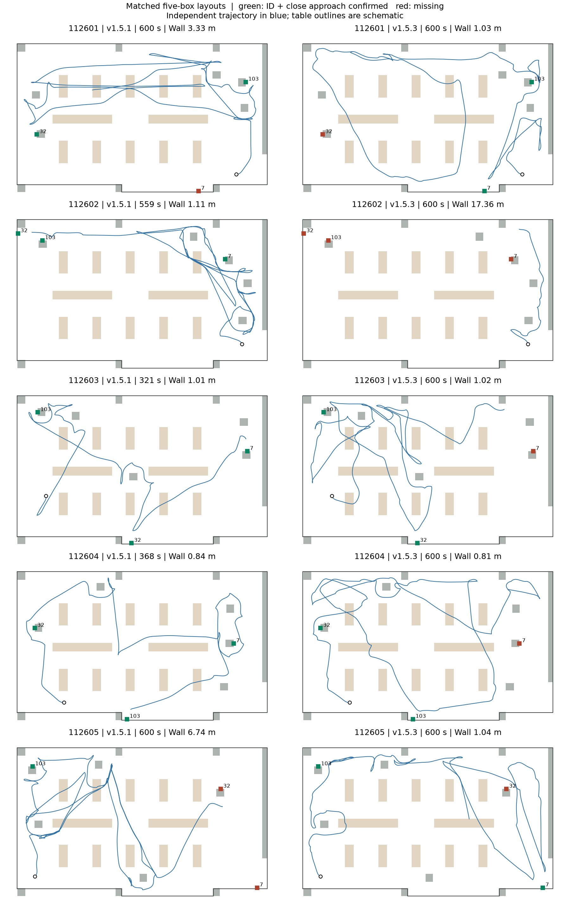

# v1.5.3 구역 전환 · 같은 5개 맵 비교

기준판은 [동결 v1.5.1의 5맵 주행](../2026-11-21_v151_track5_boxes5/README.md)이다. 직전 [v1.5.2 r2](../2026-11-21_wall_transit_v152/README.md)는 첫 맵에서 추가 비교할 수 있다. 새 후보는 두 정책과 같은 600초 제한, 480×480 5 FPS, 다섯 상자, 벽 마커 하나와 상자 마커 두 개를 쓴다. 동일한 월드 파일과 마커 배치에서 기준 회차와 출발 위치를 독립적으로 대조한다. 이 다섯 배치는 이전에 분석한 개발용 맵이다.

각 마커의 접근 성공은 ID 등록, 등록 후 독립 시뮬레이터 위치에서 실제 1.5m 이내 접근, 기존 근거리 RGB 증거를 함께 요구한다. 엄격 완주는 세 ID 모두 이 조건을 통과하고 실시간·저장 지도 모두 위치 오차 0.25m 이내이며 범퍼 접촉이 없어야 한다. 동일 구역 재방문은 평가기에서 상자 중심 2m 안에 들어갔다가 3m 밖으로 나간 뒤 다시 2m 안에서 보낸 시간을 센다. 상자 밀집 구간에서 시간이 겹치면 한 번만 센다.

근처에서 새 면을 거의 못 본 시간은 별도 보조 지표다. 연속된 정책 결정 스냅샷에서 시작 위치 주변 2.5m의 점유 표면과 방향별 RGB 관찰 상태를 대조한다. 겹치는 점유 상태가 65% 이상인 구간에서 새로 본 면의 추정 길이가 0.25m 미만이면, 그 사이 실제로 상자 2m 안에서 보낸 시간만 더한다. 누락·변형된 지도와 마지막 결정 이후 구간은 빠지므로 관측 가능한 시간과 함께 해석한다. 여기에는 관찰이 필요한 재방문도 포함될 수 있다.

[후보 정책](../../policy_candidates/2026-11-21_region_wall_v153/README.md) · [평가 코드](compare.py)

## 같은 배치에서 얻은 결과

| 배치 | 벽 ID | 벽 접근 (기존 → 후보) | 벽 최소거리 (m) | 상자 접근 (2개 중) | 완주 | 시간 (초) | 범퍼 |
|---|---:|---|---|---|---|---|---|
| 112601 | 7 | 미달 → 성공 | 3.33 → 1.03 | 2 → 1 | 미달 → 미달 | 600 → 600 | 0 → 0 |
| 112602 | 32 | 성공 → 미달 | 1.11 → 17.36 | 2 → 0 | 성공 → 미달 | 559 → 600 | 0 → 0 |
| 112603 | 32 | 성공 → 성공 | 1.01 → 1.02 | 2 → 1 | 성공 → 미달 | 321 → 600 | 0 → 0 |
| 112604 | 103 | 성공 → 성공 | 0.84 → 0.81 | 2 → 1 | 성공 → 미달 | 368 → 600 | 0 → 0 |
| 112605 | 7 | 미달 → 성공 | 6.74 → 1.04 | 1 → 1 | 미달 → 미달 | 600 → 600 | 0 → 0 |

벽 마커는 3/5 → 4/5, 상자 마커는 9/10 → 4/10, 엄격 완주는 3/5 → 0/5였다. 전체 범퍼 접촉은 0 → 0회, 평균 주행 거리는 83.8 → 75.6m, 평균 임무 시간은 489.6 → 600.0초였다. 제한 시간에 끝난 미완주 회차도 두 평균에 포함했다.

다섯 회차 합계로 상자 주변 재진입 체류는 542 → 338초였다. 새 관찰이 적었던 상자 주변 체류는 비교 가능한 1607초 중 1183초(73.6%) → 989초 중 575초(58.1%)였다. 회차마다 임무 길이와 관측 가능한 시간이 달라 비율과 합계를 함께 제시한다.

각 행의 왼쪽은 v1.5.1, 오른쪽은 v1.5.3이다. 녹색은 등록과 접근 증거를 모두 얻은 마커다. 색상과 실제 배치는 평가기가 종료 후 표시했다.

[시드별 판정 및 경로 통계](comparison.json) · [실행 시 조회한 설정](runtime_parameters.json) · [엄격 판정과 지도 오차](report.json)

## 주행 영상

- [배치 112601의 실제 시뮬레이션 녹화](https://github.com/peter010905/simul/releases/download/simulation-videos-2026-11/v153-region-wall-1121__v153-region-track-m112601-1795256846066447941.mp4)
- [배치 112602의 실제 시뮬레이션 녹화](https://github.com/peter010905/simul/releases/download/simulation-videos-2026-11/v153-region-wall-1121__v153-region-track-m112602-1795256846066447941.mp4)
- [배치 112603의 실제 시뮬레이션 녹화](https://github.com/peter010905/simul/releases/download/simulation-videos-2026-11/v153-region-wall-1121__v153-region-track-m112603-1795256846066447941.mp4)
- [배치 112604의 실제 시뮬레이션 녹화](https://github.com/peter010905/simul/releases/download/simulation-videos-2026-11/v153-region-wall-1121__v153-region-track-m112604-1795256846066447941.mp4)
- [배치 112605의 실제 시뮬레이션 녹화](https://github.com/peter010905/simul/releases/download/simulation-videos-2026-11/v153-region-wall-1121__v153-region-track-m112605-1795256846066447941.mp4)

## 중단이 포함된 회차

112602 후보 회차에는 collision_monitor heartbeat 미수신과 Nav2 lifecycle 종료·재활성화가 기록됐다. 이후 미션의 기존 nav 취소가 해제되지 않은 상태와 긴 정지 구간을 확인했다. 이 회차도 실패로 포함했다. 정책 선택의 영향과 실행 인프라 중단 영향을 이 다섯 회차만으로 분리할 수 없다. [양 정책의 액션 중단 및 최종 정지 구간](nav2-audit.json).
