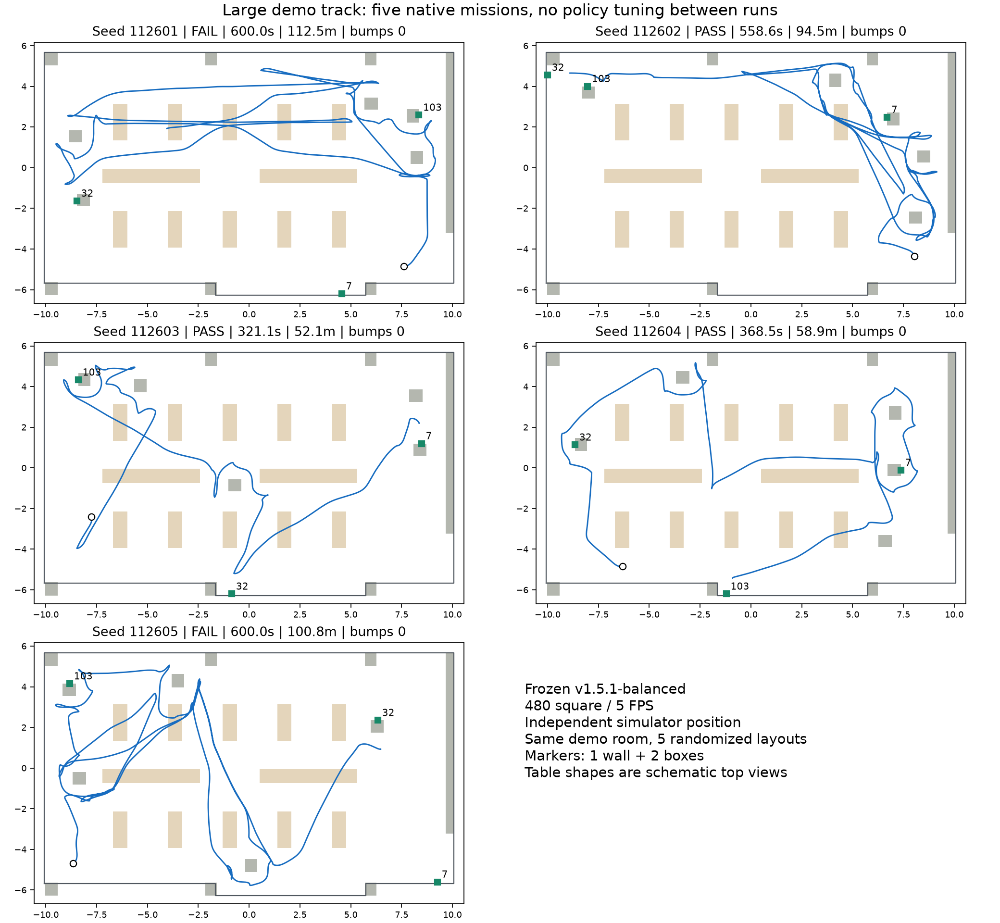
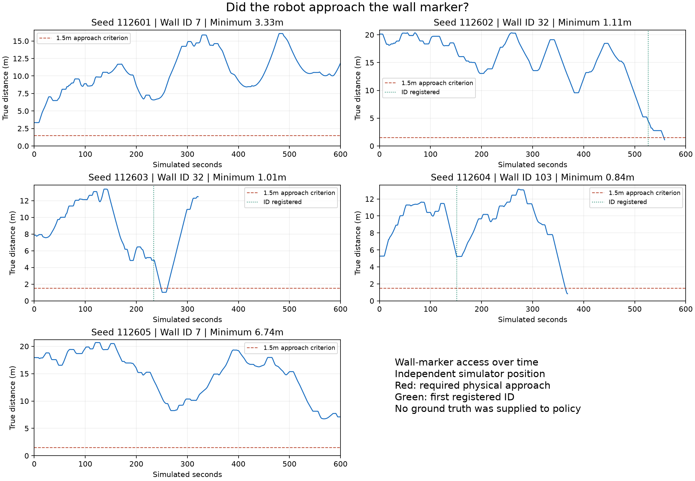

# v1.5.1 · 사진의 대형 트랙 · 상자 총 5개 · 5회 완료

엄격 통과 **3/5회**, 범퍼 **0회**, 센서·준비도 일시 중단 **1회**다. 각 회차는 하나의 새 무작위 배치이며 다른 정책과의 직접 비교가 아니다.

상자 부착 마커는 등록 9/10·근거리 영상 확인 9/10, 벽 마커는 등록 3/5·근거리 영상 확인 3/5다. 이 부분 집계는 ID 등록·RGB 증거만 나타내며, 위 엄격 완주 판정은 독립 실제 접근과 지도 오차도 요구한다.

| 초기 seed | 결과 | 등록 ID | 근거리 영상 확인 ID | 시뮬 시간 | 실제 시간 | 실제 이동 m | 범퍼 | 저장 오차 최대 |
|---|---|---|---|---:|---:|---:|---:|---:|
| 112601 | 미달 | [32, 103] | [32, 103] | 10:00.0 | 22:36.7 | 112.5 | 0 | 17.8cm |
| 112602 | 통과 | [7, 32, 103] | [7, 32, 103] | 9:18.6 | 20:28.9 | 94.5 | 0 | 5.5cm |
| 112603 | 통과 | [7, 32, 103] | [7, 32, 103] | 5:21.1 | 12:06.0 | 52.1 | 0 | 2.3cm |
| 112604 | 통과 | [7, 32, 103] | [7, 32, 103] | 6:08.5 | 12:43.1 | 58.9 | 0 | 5.0cm |
| 112605 | 미달 | [103] | [103] | 10:00.0 | 22:17.2 | 100.8 | 0 | 3.1cm |

## 조건과 판정

사용자가 지정한 20.15×11.35m demo room의 트랙·책상·기둥·남쪽 확장 공간을 사용했다. 원본 4개 상자에 하나를 추가해 **총 5개**를 무작위 배치했고 매 회차 실제 생성 개수를 검사했다. 마커는 벽 1개·서로 다른 상자 2개이며 나머지 상자 3개에는 없다. 사진 회차의 정확한 좌표를 역산한 복제는 아니며, 같은 구조의 다섯 다른 배치다.

원본 크기(7번20cm·32번25cm·103번30cm)를 유지했다. 벽에 붙는 ID가 달라지므로 벽/상자 효과와 마커 크기의 효과를 분리한 대조 실험은 아니다. 경로 그림의 책상은 상판을 위에서 본 표시이며, 실제 충돌 형상인 다리와 달라 로봇 경로가 상판 영역 아래를 통과할 수 있다.

초기 seed112601~112605를 미리 정했다. 가구 겹침을 피하는 생성기의 재추첨·격자 조정이 있을 수 있어 실제 생성 seed와 최종 spawn을 상세 기록에 남겼다. 정책은 정답 장면을 받지 않는다. 실행 도중 정책·가중치·속도·관찰 기준을 튜닝하지 않았고 실패를 성공할 때까지 재시도하지 않았다.

동결 v1.5.1-balanced, 480×480·5FPS, MPPI 전진0.25m/s·회전0.5rad/s·inflation0.45m·global costmap1Hz를 유지했다. 원래 트랙 recorder의 4Hz 변경은 사용하지 않았다. 실제 파라미터는 [조회 기록](runtime_parameters.json)을 따른다. 하나의 Gazebo씩 domain174·localhost·두 공통 lock으로 실행했고 실물 로봇은 사용하지 않았다.

각 회차 최대600초(시뮬 시간). 세 ID, 등록 후 독립 실제 거리 각각1.5m 이내, 기존 세 장1.3m 근거리 영상 증거, 초기 좌표 정렬을 고정한 live·저장 지도 오차0.25m 이내, 범퍼0을 함께 요구한다. 등록만 했거나 단순히 목표 근처를 지나간 것을 완주로 처리하지 않는다.

시뮬 속도가 실시간보다 느려 바깥 감독기의 1200초 실제 시간 한도를2400초로 늘렸다. 첫 관측기와 ROS·Gazebo는 같은 PID로 계속 실행했고 나머지 네 회차도 같은 바깥 한도를 적용했다. 시뮬600초 제한과 정책은 바꾸지 않았다. [인계 증거](supervisor_revision.json).

처음 시작한 4상자 조건은 첫 회차만 완료하고 두 번째 도중 사용자 요청으로 중단·보존했다. 그 중단을 정책 실패로 세거나 위 다섯 회차에 합산하지 않는다.

## 남은 문제와 해석

- 112601: 미등록 [7], 독립 접근 완료 False, 저장 오차 초과 {}, 정지 37.1초, 제자리 회전 93.0초, 취소 사유 {'readable_marker': 1, 'marker_hint': 1, 'inspection_due': 1, 'action_timeout': 2}.
  스케줄 단계 {'interior': 25}, 마지막 후보 수 {'interior': 37, 'wall': 190}, 선택된 목표 종류 {'interior_frontier': 2, 'interior_surface': 22, 'approach': 1}.
  약한 벽 단서 목표 선택 0회, 첫 벽 면 선택 None초, 벽 예산 구간의 내부 새 면 우선 선택 1회.
- 112602: 미등록 [], 독립 접근 완료 True, 저장 오차 초과 {}, 정지 51.4초, 제자리 회전 104.2초, 취소 사유 {'navigation_stalled': 2, 'marker_hint': 3, 'registered_marker': 1}.
  스케줄 단계 {'interior': 25, 'wall': 5}, 마지막 후보 수 {'interior': 40, 'wall': 168}, 선택된 목표 종류 {'interior_frontier': 1, 'interior_surface': 22, 'approach': 4, 'wall_surface': 2, 'focus': 1}.
  약한 벽 단서 목표 선택 2회, 첫 벽 면 선택 339.124초, 벽 예산 구간의 내부 새 면 우선 선택 2회.
- 112603: 미등록 [], 독립 접근 완료 True, 저장 오차 초과 {}, 정지 29.6초, 제자리 회전 65.6초, 취소 사유 {'marker_hint': 3, 'readable_marker': 1, 'nav': 1}.
  스케줄 단계 {'interior': 19}, 마지막 후보 수 {'interior': 50, 'wall': 183}, 선택된 목표 종류 {'interior_frontier': 1, 'interior_surface': 16, 'focus': 1, 'approach': 1}.
  약한 벽 단서 목표 선택 0회, 첫 벽 면 선택 None초, 벽 예산 구간의 내부 새 면 우선 선택 0회.
- 112604: 미등록 [], 독립 접근 완료 True, 저장 오차 초과 {}, 정지 31.9초, 제자리 회전 80.5초, 취소 사유 {'marker_hint': 2, 'registered_marker': 1, 'readable_marker': 1}.
  스케줄 단계 {'interior': 21, 'wall': 1}, 마지막 후보 수 {'interior': 27, 'wall': 189}, 선택된 목표 종류 {'interior_frontier': 1, 'interior_surface': 17, 'approach': 3, 'wall_surface': 1}.
  약한 벽 단서 목표 선택 1회, 첫 벽 면 선택 124.976초, 벽 예산 구간의 내부 새 면 우선 선택 0회.
- 112605: 미등록 [7, 32], 독립 접근 완료 False, 저장 오차 초과 {}, 정지 43.1초, 제자리 회전 127.0초, 취소 사유 {'registered_marker': 1}.
  스케줄 단계 {'interior': 29}, 마지막 후보 수 {'interior': 43, 'wall': 164}, 선택된 목표 종류 {'interior_frontier': 1, 'interior_surface': 28}.
  약한 벽 단서 목표 선택 0회, 첫 벽 면 선택 None초, 벽 예산 구간의 내부 새 면 우선 선택 3회.

정지·회전에는 필요한 관찰도 포함된다. 목표 선택 횟수는 실제 Action 전송 횟수와 구분한다. sensor_interruptions는 카메라뿐 아니라 Nav2 등 준비도 검사 취소도 포함하는 정책 카운터다. 3회차에는 nav2_unavailable로 목표를 보존했다가 자동 재개한 기록이 있으며, 이를 카메라 프레임 유실로 해석하지 않는다. 보드의 진행 중 거리 표시가 독립 기록보다 크게 나오는 구간이 있어 위 거리와 경로는 시뮬레이터 위치로 다시 계산했다. 상자 추가의 인과 효과나 모든 밀집 환경에서의 최적성을 입증하는 비교는 아니다. 실물의 케이블·탑재 중량·OAK-D blur·RPi/Create3 부하는 검증하지 않았다.

[벽 우선순위 결함·실제 영상 근거](WALL_FINDING.md) · [상세 결과](result.json) · [집계](summary.json) · [다섯 영상](videos.md) · [보드](http://192.168.252.2:8780/)

보드 카드: `v151-boxes5-track-m112601-trial1`~`v151-boxes5-track-m112605-trial5`. 영상은 실제 Gazebo RGB이며 시청용MP4만5FPS로 재표본화했다. 원래 수신 프레임으로 검출·타이밍을 평가했다. 지도·ROS 원본·영상 바이너리는 Git에 넣지 않고 VM과 Mac 아티팩트에 보존한다.
