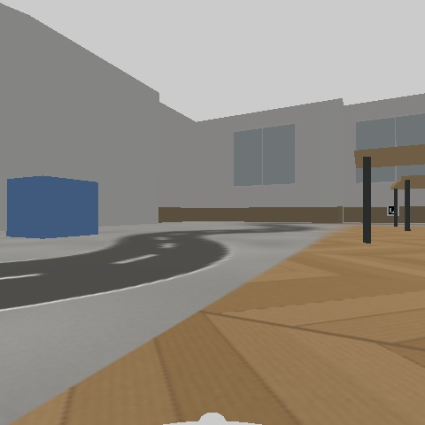

# 벽 관찰 누락 · 코드와 첫 두 회차 근거

현재 5회 비교는 동결 v1.5.1로 계속 진행하며 이 분석 때문에 주행 정책을 바꾸지 않았다. 상자 5개 조건 첫 회차는 상자32·103을 찾았고 벽7은 놓쳤다. 두 번째는 세 ID 모두 찾았다. 첫 회차 하나로 모든 벽 실패의 원인을 확정하지 않는다.

**Confirmed — 마지막 벽 관찰 예산을 우회하는 조기 반환.** [동결 center_wall.py](../../policy_releases/2026-11-21_mixed_camera_sync_v151/src/osp_mission/osp_mission/center_wall.py)의 `CenterWall.decide`는260행에서 벽 예산을 `min(0.15×duration, 12+5×벽후보수)`로 계산한다. 하지만262~270행에서 `fresh` 내부 면이 있으면 바로 반환하므로276행의 남은 시간 검사를 통과하지 않는다. `probe_only`와 혼잡 영역의 별도 조기 반환도 있으므로 수정 시 함수 계약을 함께 보아야 한다. 이 파일은 v1.2에서 보존된 파일이며 카메라 동기화 수정에서 새로 추가한 로직이 아니다.

첫 회차 로그의 마지막 선택은556.176초, 내부 후보37개·벽 후보190개·`unseen_reachable_object`였다. 이때 벽 예산은90초이고 남은 시간은43.824초였지만 내부 면을 골랐다. 전체 선택 로그는 내부 면22회·내부 frontier2회·마커 접근1회, 벽 면0회였다. 이는 실제 Nav2 Action 전송 횟수와는 구분한다. 두 번째는 내부 단계25건·벽 단계5건, 벽 면 선택2건이 있었고 벽32가526.644초에 등록돼 늦게 접근을 마쳤다.

**Confirmed — 첫 회차는 벽7을 충분히 가까이 확인하지 못했다.** 실제 최소거리는3.3347m이며 검출기 ID7 판독 기록이 없었다. 상자32·103의 실제 최소거리는0.913m·0.618m였다. 따라서 이미 읽은 벽 ID가 단순히 등록 단계에서 유실됐다고 주장할 근거는 없다.

**근사 분석 — 작게 스친 관찰 기회.** [실제 카메라 K·고정 TF](camera_geometry.json)와 독립 실제 이동 기록으로 수평 투영만 계산하면 최대 가로 폭은11.74px, 8px 이상 기회는39프레임이고18px 이상은0프레임이다. [전체 결과](wall-audit-112601.json). 가림·수직 시야·차체 roll/pitch를 무시하므로 이 수가 실제 보임/읽힘의 정답은 아니다. 특히 시작 근처의 가장 큰 투영 기회는 기둥에 가려질 수 있다.

199.368초 영상의 오른쪽 가장자리 가까운 작은 흑백 패턴은 벽7의 정답 투영 위치(u≈444px)와 맞는다. 가로 폭은 수평 근사10.36px이며 앞쪽 책상 다리로 일부 가려질 수 있다. 저장 JPEG는 실제 입력의 압축 기록이므로 원본 픽셀의 완전한 대체물은 아니다. 이 작은 패턴을 모델이 벽 후보로 수용했는지, 유지했다가 버렸는지는 현재 저장 로그만으로 확정하지 않는다.

**Likely — 벽 확인이 뒤로 밀리는 스케줄이 누락에 기여한다.** 내부 새 면이 남아 있을 때 벽 예산과 약한 벽 단서가 계속 양보할 수 있다. 첫 회차의 최종 벽후보190개는 기존 기하·costmap 연결·시선·veto 필터를 통과한 벽 분류 관찰점 수이며, 마커7에 딱 맞는 실제 Nav2 경로가 보장됐다는 의미는 아니다.

수정 방향은 `probe_only`의 내부 면 조회 계약과 확인 마커 접근·안전 복구 우선순위를 유지하면서, 벽 예산 검사를 내부의 조기 반환보다 먼저 적용하는 별도 버전이다. 작은 벽 단서를 따라갈 조건도 따로 계측해야 한다. 내부 관찰을 너무 일찍 끊으면 미확인 상자 마커를 놓치거나 왕복이 늘 수 있다. 따라서18px ID확인·충돌 여유를 낮추는 대신 같은 다섯 배치에서 별도 비교해야 한다. 아직 이 수정의 완주율 개선은 검증하지 않았다.
