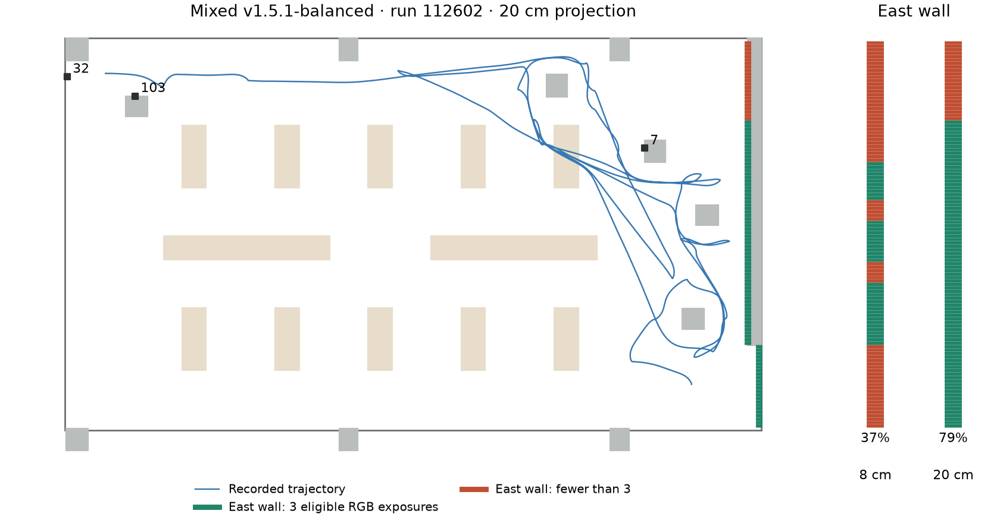

# 112602 동쪽 벽의 촬영 기회와 벽 구간 선택 실험

사용자가 올린 그림의 궤적과 상자 배치는 대형 트랙 두 번째 주행(112602)과 일치한다. 7번은 상자에 있었고 벽 마커 32번은 서쪽 벽에 있었다. 세 마커 모두 이 회차에서 근거리 확인됐다. 동쪽 벽에는 정답 마커가 없어, 그곳에 마커가 있었다면 어땠을지를 촬영 기회로 평가했다.

기록된 RGB 2,793장의 타임스탬프, Gazebo의 독립 궤적·헤딩, 기록된 카메라 K와 고정 TF를 사용했다. 동쪽 외벽과 안쪽으로 돌출된 긴 벽의 남북 방향 면을 112개 균등 표본으로 나눴다. 마커 중심 높이 0.32m에서 기존 18px·0.85 여유 계수·입사각 조건을 적용했다. 실제 촬영 위치에서 수평·수직 화면 안에 들어오고 0.15초 이상 떨어진 노출이 3장 이상인 길이 비율을 셌다.

| 가정한 마커 한 변 | 조건을 충족한 동쪽 벽 표본 | 길이 비율 |
|---|---:|---:|
| 8cm (기존 정책의 작은 마커 기준) | 41/112 | 36.6% |
| 20cm (이 회차의 상자 7번 크기) | 89/112 | 79.5% |

이 수치는 영상에서 ID를 판독할 확률이 아니다. 가림, 움직임에 의한 흐림, 감지기의 실제 처리 여부를 제외한 기하학적 기회다. 초록은 세 번 이상 기회가 있었던 구간, 붉은색은 그 기준에 미달한 구간이다. 표본에는 동서 방향 모서리의 짧은 턱은 포함하지 않았다.

## 같은 기록의 목표 선택 비교

동결 v1.5.1과 별도 보완판에 당시 저장한 SLAM 격자, 방향별 RGB 관찰 기록, 로봇 자세와 후보를 순서대로 넣었다. 위치와 관찰 기록은 원래 로봇의 궤적을 따르고, 두 정책은 각자 선택한 목표 이력을 쌓는다. 원본 Nav2 costmap과 시각별 map→odom, 상자 추적 상태, 마커 접근 중단 이벤트는 이 입력에 없어 공통 여유 격자와 고정 좌표 변환으로 대체하거나 생략했다.

| 원래 주행 | 계획 입력 수 | 원본 선택기의 벽 목표 | 보완판의 벽 목표 |
|---|---:|---:|---:|
| 112601 | 25 | 0 | 5 |
| 112602 | 30 | 0 | 7 |

112602 재생에서 선택한 벽 목표 7개 중 2개가 정답 동쪽 벽선 35cm 이내의 표면을 향했다. 첫 선택 시각은 83.1초였다. 좌표 정렬과 정답 배치는 선택 이후의 대조에만 사용했다.

실제 112602 원본 로그에는 벽면 목표 선택 2회가 남았다. 표의 원본 0회는 제한된 입력으로 다시 실행한 값이다. 이 실험은 단서 없이도 벽 목표가 다시 선택되는지를 검증한다. 새 경로, 실제 Nav2 도달, 주행 시간과 발견률 변화는 측정하지 않았다. 별도 Jazzy workspace에서 빌드하고 정책·카메라·접근·안전 관련 테스트 30개를 통과했다.

[촬영 기회 수치](east_wall_opportunities.json) · [선택 기록](paired-replay.json) · [보완판](../../policy_candidates/2026-11-21_v151_wall_sections/README.md)
