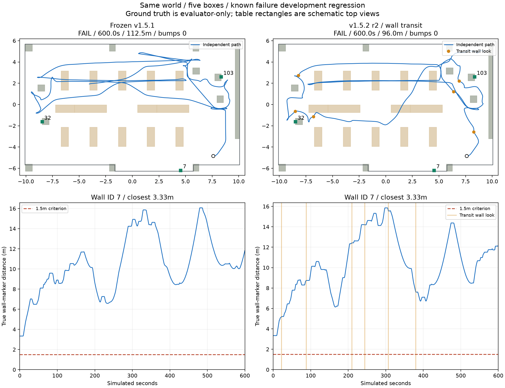
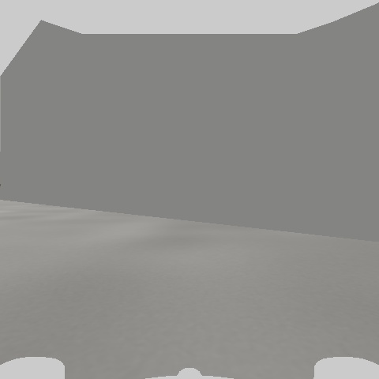

# v1.5.2 r2 · 이동 중 벽 관찰 · 동일 맵 개발 회귀 완료

벽 관찰 요청 **6회**, 새 처리 영상3장 이상을 확인한 관찰 **6회**, 원래 이동 재개 예약 **6회**를 기록했다. 이번 한 회차의 엄격 결과는 **미달**이며 범퍼는 **0회**다.

이미 원인을 분석한 seed112601 한 곳의 개발 회귀이다. 새 정책의 일반 완주율이나 미사용 맵 성능을 입증하지 않는다. v1.5.1·실물 기본값은 보존하며 새 후보는 명시적으로 선택한다.

| 항목 | 동결 v1.5.1 | v1.5.2 r2 |
|---|---:|---:|
| 엄격 완주 | False | False |
| 등록 ID | [32, 103] | [32, 103] |
| 근거리 RGB 확인 ID | [32, 103] | [32, 103] |
| 벽 마커 실제 최소거리 | 3.335m | 3.335m |
| 시뮬 시간 | 10:00.0 | 10:00.0 |
| 실제 경과 | 22:36.7 | 21:35.2 |
| 독립 실제 이동 | 112.5m | 96.0m |
| 범퍼 | 0 | 0 |
| 정지 시간 | 37.1s | 63.4s |
| 제자리 회전 | 93.0s | 121.6s |
| 저장한 ID의 지도오차 최대 | 17.8cm | 23.9cm |

미등록 ID를 지도오차0으로 인정하지 않는다. 엄격 완주는 세 ID와 등록 후 각각 실제1.5m 접근, 기존 세 장1.3m 영상 증거, 고정 초기 정렬의 live·저장 지도오차0.25m, 범퍼0을 모두 요구한다.

벽 관찰을 요청한 실제 로봇 위치를 주황 점으로 표시했다. 책상은 상판 도식이며 실제 다리 충돌 형상과 다르다. 바뀐 센서·제어 경로를 똑같은 궤적으로 재현한 실험은 아니다. 시뮬 시간으로 임무 비용을 비교하고 실제 경과는 VM 부하와 구분한다.

## 실제 벽 관찰과 복귀

관찰에 직접 쓴 시간은 21.5초, 복귀 방향 전환까지 포함해 차감한 예산은 31.6초였다. 미션의 실제 navigation 재개 로그는 6건이다. 정지·회전 시간 차이 전체가 이 기능 때문이라고 해석하지 않는다.

두 회차 모두600초에 미완주했다. 거리 감소와 정지·회전 증가가 함께 나타났으므로 이동거리가 짧아졌다는 것만으로 탐색 효율이 개선됐다고 판단하지 않는다.

| 미션 경과 | 회전 요청 | 새 처리 프레임 | 종료 이유 | 복귀 예약 | 이후10초 실제 이동 |
|---:|---:|---:|---|---|---:|
| 21.9s | -75° | 6 | processed_frame_dwell | True | 2.12m |
| 87.9s | -45° | 4 | processed_frame_dwell | True | 1.07m |
| 209.4s | -60° | 6 | processed_frame_dwell | True | 0.67m |
| 243.9s | -45° | 4 | processed_frame_dwell | True | 1.15m |
| 306.9s | 45° | 7 | processed_frame_dwell | True | 2.32m |
| 379.9s | 45° | 6 | processed_frame_dwell | True | 2.29m |

복귀 예약과 실제 이동은 별도 증거다. 새로운 마커 정보가 생기면 이전 목표를 재개하지 않고 정상 마커 계획으로 돌아간다. 계획한 면의 길이를 실제 카메라 관찰 완료량으로 계산하지 않는다. ID·근거리 증거·기존 coverage는 실제 센서 경로에서만 갱신한다.

성공한 첫 관찰의 저장 RGB JPEG, 미션 25.900초·프레임130. 원시 입력과 동일하다는 뜻은 아니다.

## 적용과 검증 범위

이동 중 미관찰 벽 유사 면을 짧게 확인하고 복귀하는 기능, 마지막 벽 시간 예산의 조기 반환 우회 수정을 별도 버전에 적용했다. 한 번의 비교에서는 두 변경의 효과를 각각 분리할 수 없다. 작은 후보 검출 모델 자체는 바꾸지 않았다.

첫 벽 면 목표 선택은 532.9초, 마지막 예산 사유의 첫 선택은 532.9초였다. 예산 검사는 목표 재선택 시점에 적용된다. 진행 중인 긴 내부 이동은 벽 전환을 늦출 수 있으므로 마지막90초 전체를 벽 관찰에 보장했다고 해석하지 않는다.

실제 조회한 MPPI·smoother·footprint·inflation·costmap 주기·18px/3프레임 판독 설정은 기준판과 같았다. 480×480·5FPS를 유지한다. world SHA256·배치·예정 spawn을 그대로 사용하고 정답 위치는 평가기에만 제공했다. 확인된 마커 접근·안전 복구를 보호하며 관찰 실패를 인식 성공으로 바꾸지 않는다.

새 코드20개·기존 동작 제어9개,29개 검사와 빌드를 통과했다. 기록기의8개 동시 작성자 검사도 통과했다. 옛 NearPassInspection 기하 검사3개는 원본 v1.5.1에서도 동일하게 실패했고 원본을 바꿔 숨기지 않았다. 새 선택기는 해당 옛 choose를 호출하지 않는다.

개발 r1은 일반 면 예약까지 보호하는 버그를 발견해88.6초에 중단·보존했다. 첫 r2는 약180초의 기록기 latest.tmp 동시 저장 충돌로 미완료됐다. 각각 [개발 중단](development_aborted_r1.json)·[인프라 실패](infrastructure_failure_first_r2.json)로 분리한다. 완료 결과에 합산하지 않는다. 기록기를 고친 뒤 동일 r2 소스 해시로 이번 회차만 다시 실행했으며 성공할 때까지 정책 실패를 재시도하지 않았다. 관측기의 원자적 저장 수정은 ROS 목표·센서·제어 파라미터를 바꾸지 않는다.

## 남은 한계

벽 관찰 기능은 발동했지만 이번 회차의 전체 완주 향상은 확인하지 못했다. 결과를 기본 정책 승격의 근거로 사용하지 않는다.

벽7의 실제 최소거리는 3.335m였고 판독기 ID 기록은 없었다. 벽을 향한 관찰 목표가 생겨도 남은 시간에 미관찰 벽 구간까지 이동하지 못하면 탐색을 완료할 수 없다. 이 실행에서는 이동 중 벽 정보 수집과 남은 벽 구간을 고르는 경로 선택을 구분해야 한다.

후보 취소 사유 {'near_pass_inspection': 6, 'readable_marker': 1, 'marker_hint': 1, 'registered_marker': 1}, 스케줄 단계 {'interior': 26, 'wall': 7}, 마지막 벽 예산 우회 기록 0건. 마지막 값0은 이 실행에서 해당 선택이 기록되지 않았다는 뜻이며, 모든 마커를 볼 수 있었다는 증명은 아니다.

[정책 설명·재현](../../policy_candidates/2026-11-21_mixed_wall_transit_v152/README.md) · [상세 비교](result.json) · [집계](summary.json) · [실제 설정](runtime_parameters.json) · [관측기 수정](observer_revision.json) · [주행 영상](videos.md) · [보드](http://192.168.252.2:8780/)
