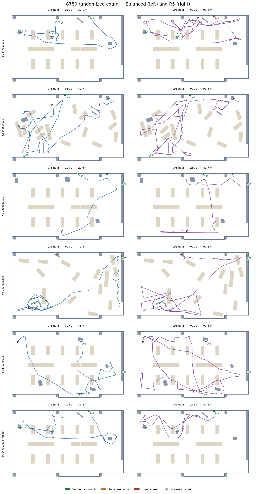

# 8780 무작위 시험장 주행 결과

등록한 6쌍 중 6쌍의 양쪽 주행이 끝났다. 같은 출발 자세와 월드, 온전한 계측을 확인한 쌍은 6개다.

| 처음 주행한 배치 | 엄격 완주 | ID 등록 | 1.5m 접근 | 벽 접근 | 장애물 접근 | 범퍼 | 오등록 | 평균 소요(초) | 평균 거리(m) |
|---|---:|---:|---:|---:|---:|---:|---:|---:|---:|
| Balanced | 4/5 | 14/15 | 14/15 | 9/10 | 5/5 | 0 | 0 | 364.6 | 53.4 |
| R5 | 1/5 | 11/15 | 11/15 | 8/10 | 3/5 | 0 | 0 | 527.7 | 86.9 |

시간은 엄격 완주의 마지막 근거리 증거 시각이며 미완주에는 600초를 배정했다. 아래 주행 시간은 실제 시뮬레이션 종료 시각이다.

| 배치 | 시드 | 책상 | 이동식 장애물 수 | 실제 등록 후 접근 ID (Balanced / R5) | 종료 시간(초) (Balanced / R5) | 엄격 완주 (Balanced / R5) | 비교쌍 |
|---|---:|---|---:|---|---|---|---|
| 1 첫 주행 | 647911238 | 기존 배치 | 4 | 149·173·518 / 173·518 | 258.9 / 600.0 | 1 / 0 | 유효 |
| 2 첫 주행 | 545514539 | 재배치 | 4 | 443·542·600 / 542·600 | 530.2 / 600.0 | 1 / 0 | 유효 |
| 3 첫 주행 | 3280183581 | 기존 배치 | 3 | 41·158·556 / 41·158·556 | 129.1 / 238.8 | 1 / 1 | 유효 |
| 4 첫 주행 | 2437656298 | 재배치 | 1 | 299·862 / 299·862 | 600.0 / 600.0 | 0 / 0 | 유효 |
| 5 첫 주행 | 178349315 | 기존 배치 | 4 | 268·425·662 / 425·662 | 306.6 / 600.0 | 1 / 0 | 유효 |
| 6 반복 | 647911238 | 기존 배치 | 4 | 149·173·518 / 149·173·518 | 262.9 / 293.3 | 1 / 1 | 유효 |

양쪽 모두 엄격 완주한 신규 배치 1개에서 마지막 확인까지 평균은 Balanced 128.6초, R5 238.3초였다.

### 책상 배치별 첫 주행

| 배치 조건 | 정책 | 엄격 완주 | 벽 접근 | 장애물 접근 |
|---|---|---:|---:|---:|
| 책상까지 무작위 | Balanced | 1/2 | 3/4 | 2/2 |
| 책상까지 무작위 | R5 | 0/2 | 3/4 | 1/2 |
| 원래 책상 배치 | Balanced | 3/3 | 6/6 | 3/3 |
| 원래 책상 배치 | R5 | 1/3 | 5/6 | 2/3 |

### 접근을 마치지 못한 마커 (5개 독립 배치)

| 확인한 마지막 단계 | Balanced | R5 |
|---|---:|---:|
| 등록 후 근거리 증거 부족 | 0 | 0 |
| 주행 중 번호 판독 후 미등록 | 0 | 2 |
| 판독 가능한 기하 조건에서 주행 중 판독 0회 | 0 | 0 |
| 예상 크기가 작은 시야만 확보 | 0 | 0 |
| 6px 이상으로 가림 없이 볼 기회 없음 | 1 | 2 |

카메라 보정값, 시뮬레이션 안의 실제 인쇄물·가림과 영상 시각을 대조했다. 기하학적으로 보일 기회와 검출기가 실제로 번호를 읽은 횟수를 구분했다.

| 정책 | 정지·저속 시간(평균 초) | 선택한 목표 | 같은 종류·35cm 내 재선택 |
|---|---:|---:|---:|
| Balanced | 127.7 | 122 | 5 |
| R5 | 158.8 | 151 | 8 |

저속 기준은 0.02m/s이며 제자리 회전과 촬영 대기도 포함한다. 같은 위치의 목표는 서로 다른 방향을 보려는 방문도 포함할 수 있다.

### 실제 카메라가 처리한 시각의 표면 관찰 기회 (5쌍)

| 정책 | 벽 관찰 가능 구간 | 장애물 관찰 가능 구간 | 네 면 관찰 기회가 있었던 상자 | Nav2 실패 | Nav2 취소 |
|---|---:|---:|---:|---:|---:|
| Balanced | 37.2% | 64.0% | 4/12 | 0 | 23 |
| R5 | 50.9% | 62.2% | 0/12 | 0 | 36 |

높이 32cm에 20cm 인쇄물을 붙일 수 있는 구간을 최대 40cm 간격으로 표본 조사했다. 처리된 영상 세 장에서 1초 안에 최단 변 18픽셀, 입사각 60° 이내, 네 모서리와 중심까지 시야 확보를 요구했다. 직사각 상자는 각 면의 표본 70% 이상을 네 면에서 충족해야 센다. 실제 ID 판독과 근거리 접근은 위 표에서 별도로 채점했다.

반복 회차는 독립 배치 수에 더하지 않았다. 이 결과의 범위는 정해진 시험장과 추첨된 배치, 사용한 센서 조건이다.

같은 배치 647911238과 출발 자세를 쓴 R5 두 주행은 첫 계획 때부터 SLAM 입력이 달랐다. 첫 주행은 빈 격자 3,209개, 반복 주행은 3,550개를 사용했다. 각 회차의 종료 시각은 600.0초와 293.3초였다. SLAM 입력 차이가 최종 결과에 어느 정도 기여했는지는 이 두 주행으로 분리할 수 없다. [첫 결정에 실제 사용된 지도와 입력 집계](repeat-first-decision.json)

## 주행 영상

| 배치 | 정책 | 원본 카메라 영상 |
|---|---|---|
| 647911238 | Balanced | [MP4 다운로드](https://github.com/peter010905/simul/releases/download/simulation-videos-2026-11/v151-random-exam-112209__v151-survey-baseline-track-m647911238-1066999508311362768.mp4) |
| 647911238 | R5 | [MP4 다운로드](https://github.com/peter010905/simul/releases/download/simulation-videos-2026-11/v151-random-exam-112209__v151-survey-candidate-track-m647911238-1066999508311362768.mp4) |
| 545514539 | R5 | [MP4 다운로드](https://github.com/peter010905/simul/releases/download/simulation-videos-2026-11/v151-random-exam-112209__v151-survey-candidate-track-m545514539-663389709141213120.mp4) |
| 545514539 | Balanced | [MP4 다운로드](https://github.com/peter010905/simul/releases/download/simulation-videos-2026-11/v151-random-exam-112209__v151-survey-baseline-track-m545514539-663389709141213120.mp4) |
| 3280183581 | Balanced | [MP4 다운로드](https://github.com/peter010905/simul/releases/download/simulation-videos-2026-11/v151-random-exam-112209__v151-survey-baseline-track-m3280183581-269900596522503902.mp4) |
| 3280183581 | R5 | [MP4 다운로드](https://github.com/peter010905/simul/releases/download/simulation-videos-2026-11/v151-random-exam-112209__v151-survey-candidate-track-m3280183581-269900596522503902.mp4) |
| 2437656298 | R5 | [MP4 다운로드](https://github.com/peter010905/simul/releases/download/simulation-videos-2026-11/v151-random-exam-112209__v151-survey-candidate-track-m2437656298-526684097893377877.mp4) |
| 2437656298 | Balanced | [MP4 다운로드](https://github.com/peter010905/simul/releases/download/simulation-videos-2026-11/v151-random-exam-112209__v151-survey-baseline-track-m2437656298-526684097893377877.mp4) |
| 178349315 | Balanced | [MP4 다운로드](https://github.com/peter010905/simul/releases/download/simulation-videos-2026-11/v151-random-exam-112209__v151-survey-baseline-track-m178349315-106374630088071414.mp4) |
| 178349315 | R5 | [MP4 다운로드](https://github.com/peter010905/simul/releases/download/simulation-videos-2026-11/v151-random-exam-112209__v151-survey-candidate-track-m178349315-106374630088071414.mp4) |
| 647911238 (순서 반전 반복) | R5 | [MP4 다운로드](https://github.com/peter010905/simul/releases/download/simulation-videos-2026-11/v151-random-exam-112209__v151-survey-candidate-track-m647911238-328852813392071914.mp4) |
| 647911238 (순서 반전 반복) | Balanced | [MP4 다운로드](https://github.com/peter010905/simul/releases/download/simulation-videos-2026-11/v151-random-exam-112209__v151-survey-baseline-track-m647911238-328852813392071914.mp4) |

영상의 파일 지문과 크기는 GitHub Release의 값과 대조했다. [영상 지문](media.json) · [실행 당시 등록 지문](receipt.json)
