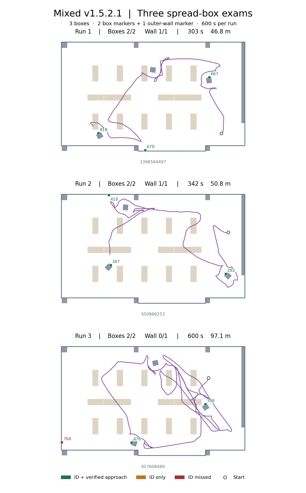

# 상자 3개를 흩어 놓은 8780 시험장 주행

Mixed v1.5.2.1은 세 지도에서 마커 8/9장의 ID를 읽었고 등록 후 8/9장에 1.5m 이내로 접근했다. 상자는 6/6장, 벽은 2/3장이었다. 세 장 모두 접근하고 지도 오차와 충돌 기준을 함께 만족한 주행은 2/3회였다.

| 회차 · 시드 | 벽 위치 | ID 등록 | 상자 접근 | 벽 접근 | 주행 시간 | 거리 | 범퍼 | 주행 영상 |
|---|---|---:|---:|---:|---:|---:|---:|---|
| 1 · 1398584497 | 남쪽 안쪽 벽 | 3/3 | 2/2 | 1/1 | 5:03 | 46.8 m | 0 | [영상](https://github.com/peter010905/simul/releases/download/simulation-videos-2026-11/v152-final-spread-three-1122__v151-survey-focus-track-m1398584497-23239317248697326.mp4) |
| 2 · 550866253 | 북쪽 | 3/3 | 2/2 | 1/1 | 5:42 | 50.8 m | 0 | [영상](https://github.com/peter010905/simul/releases/download/simulation-videos-2026-11/v152-final-spread-three-1122__v151-survey-focus-track-m550866253-188862315828381463.mp4) |
| 3 · 417608489 | 서쪽 | 2/3 | 2/2 | 0/1 | 10:00 | 97.1 m | 0 | [영상](https://github.com/peter010905/simul/releases/download/simulation-videos-2026-11/v152-final-spread-three-1122__v151-survey-focus-track-m417608489-197242287164937263.mp4) |

## 마커별 판정

| 회차 | ID | 부착 위치 | ID 등록 시각 | 1.5m 접근 검증 시각 | 등록 후 최소 거리 | 지도 오차 |
|---|---:|---|---:|---:|---:|---:|
| 1 | 818 | 상자 1 | 4:59 | 5:02 | 1.00 m | 6.4 cm |
| 1 | 667 | 상자 2 | 1:13 | 1:14 | 1.00 m | 4.1 cm |
| 1 | 679 | 남쪽 안쪽 벽 | 3:59 | 4:11 | 1.04 m | 7.6 cm |
| 2 | 418 | 북쪽 | 3:58 | 4:10 | 0.76 m | 2.7 cm |
| 2 | 282 | 상자 3 | 0:30 | 0:41 | 0.69 m | 2.4 cm |
| 2 | 347 | 상자 1 | 5:36 | 5:41 | 1.11 m | 4.2 cm |
| 3 | 768 | 서쪽 | 미등록 | 미확인 | — | — |
| 3 | 476 | 상자 2 | 2:45 | 2:46 | 0.93 m | 11.3 cm |
| 3 | 350 | 상자 1 | 0:02 | 0:19 | 0.69 m | 2.0 cm |

출발점은 흰 원, ID 등록 후 근거리까지 확인한 마커는 초록색, 등록만 된 마커는 주황색, 미등록은 빨간색이다. 궤적은 Gazebo에서 기록한 위치를 사용했다.

## 시험 조건

원래 시험장의 책상과 다리를 고정하고 상자 세 개를 서로 다른 구역에 두었다. 지도별 최소 상자 중심 간 거리는 6.27m, 6.81m, 7.34m였다. 서로 다른 두 상자에 마커 한 장씩, 외곽 벽에 한 장을 붙였다. 마커 번호, 부착면, 출발 위치와 방향은 시작 전에 추첨했다. 정책은 총수 3개만 안다. [사전 배치 기록](enrollment.json)

카메라는 480×480, 초당 5프레임이고 제한 시간은 시뮬레이션 10분이다. 채점은 등록 후 실제 거리 1.5m 이내의 독립 위치 기록과 로봇 센서의 근거리 관측 증거를 함께 요구한다. 세 장을 모두 확인한 뒤 오등록과 범퍼 접촉이 없고 각 지도 위치 오차가 25cm 이하여야 엄격 완주다. [개별 측정값과 영상](scores.json)

세 회차 모두 같은 후보로 한 번씩 주행했다. 기존 정책과 같은 지도에서 맞붙은 실험은 수행하지 않았으므로 세 결과로 버전 간 우열을 평가할 수 없다.

세 출발 자세는 독립적으로 추첨했으며 실제 세 출발점은 모두 시험장 동쪽 절반에 있었다. 벽 마커가 놓인 곳은 회차 순서대로 남쪽 안쪽 벽, 북쪽, 서쪽이었다.

## 마지막 주행에서 놓친 서쪽 벽

768번과 로봇 사이의 최소 거리는 7.42m였다. 실시간 검출기의 768번 누적 판독은 0회였다. 저장된 전방 JPEG에 OpenCV ArUco Original 기본 판독기를 적용하면 37프레임에서 768번을 읽는다. 실제 검출된 사각형의 짧은 변은 5~9px였고 첫 판독은 110.9초였다. 이 프레임들에서 검출 중심과 원래 벽 마커의 투영 중심 사이의 차이는 최대 1.02px였다.

실제 카메라 보정값과 기록한 자세로 시야를 재구성했을 때, 가림 없이 네 꼭짓점과 중심이 모두 보이고 짧은 변이 6px 이상 18px 미만인 프레임은 92개였다. 18px 이상인 프레임은 0개였다. 이 수치는 도형의 투영 예측이며 위의 37프레임은 저장 영상의 픽셀로 판독한 값이다. [프레임별 측정](west-wall.json)
