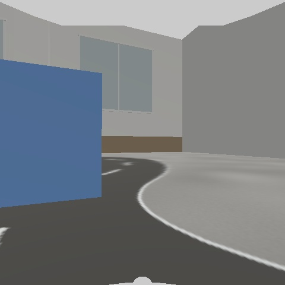
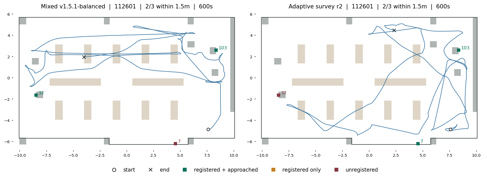
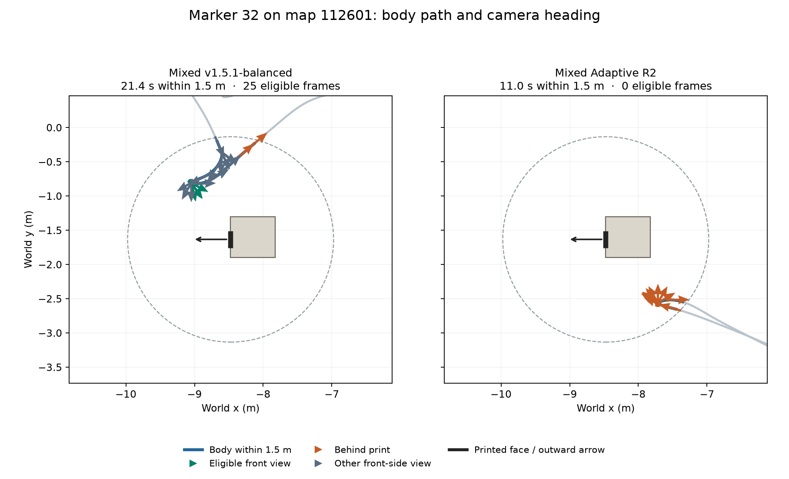

# 재현 실험과 실패 원인

## 600초가 끝났을 때 무엇을 놓쳤나

기준 정책의 트랙 5회에서 내부 표면 목표는 105번, 벽 표면 목표는 3번 선택됐다. 이 수치는 선택 로그이며 Nav2가 실제 완료한 목표 수와는 다르다. 다섯 회차 모두 카메라 처리 지연의 95백분위는 시뮬 시간 84~88ms였고 두 실패 회차의 센서 중단 횟수는 0이었다. 두 회차 모두 범퍼 접촉도 0이었다. 카메라 수신은 유지됐지만 읽을 만한 각도로 해당 면을 보는 경로가 만들어지지 않은 사례다. [기준 측정](../2026-11-21_v151_track5_boxes5/result.json)

| 기준 배치 | 실제 관찰 | 놓친 이유를 뒷받침하는 자료 |
|---|---|---|
| 112601 | 32·103 접근. 남쪽 벽 7 누락 | 내부 표면 22회, 벽 표면 0회. 최소거리 3.335m. 199.368초 저장 영상에서 추정 투영폭은 약 10.4px였으나 동결 OpenCV 재생에서 해당 위치의 4각형 제안이 없었다. |
| 112605 | 103 접근. 벽 7과 상자 32 누락 | 내부 표면 28회, 벽 표면 0회. 벽까지 최소거리 6.742m. 가림을 무시한 벽 마커 최대 추정폭도 4.18px였다. 599.976초의 마지막 목표 선택에서 내부 후보 43개, 벽 후보 164개가 남아 있었다. |

112605의 상자 32는 다른 실패를 보여준다. 로봇 중심이 마커 위치에서 1.285m까지 접근했고 1.5m 안에서 실제 영상 48장을 기록했다. 이 트랙 원본 SDF에서 흰 종이는 마커 모델의 로컬 X축 −2mm, 검은 셀은 −4mm에 놓인다. 따라서 마커 앞면의 법선은 모델의 −X 방향이다. 이 부호를 적용해 실제 영상 시각과 카메라 보정값을 대입하면 가까웠던 영상 48장 중 앞면이 수평 시야에 온 경우는 0장이다. 전체 2,999장에서도 앞면의 최대 예상 폭은 2.71px였다. 같은 기록의 JPEG 독립 판독도 ID 32는 0장이다. 수평 투영은 가림이나 수직 잘림을 반영하지 않아서 실제 가시성을 높게 추정할 수 있다. [투영 수치](near-miss-112605.json) · [재현 도구](near_miss.py)

## 저장된 목표 선택 재생

두 실패 주행에서 목표 선택 시점의 지도와 이미 관찰한 면을 재사용한다. 112601은 25개 시점, 112605는 29개 시점이다. 각 정책에는 같은 시각의 로봇 위치·방향과 원래 Flow 후보를 주며, 모의 선택 이력은 각자 따로 쌓는다. 저장 당시의 Nav2 costmap, 실시간 물체 추적, 실패 후보 제외 기록, 마커 주행 중단 신호가 없으므로 알려진 자유 공간과 32cm 여유로 대체한다. 원본 선택기의 벽 선택은 두 배치 모두 0번이었다. 수정판 r2는 112601에서 벽 10번·내부 6번·프런티어 8번, 112605에서 벽 10번·내부 7번·프런티어 12번을 골랐다. 첫 벽 선택은 각각 15.7초와 39.5초였다. 112601에서는 양쪽 모두 한 시점에 반환 가능한 일반 목표가 없었다. 이 수치로 실제 목표 도착이나 마커 접근 성공 여부를 판정할 수는 없다. [방법](replay.py) · [원본 선택](replay-baseline.json) · [수정판 선택](replay-candidate.json)

## 실제 Gazebo 비교

원래 다섯 트랙은 보존된 월드와 출발 자세, 같은 시뮬 시간 제한을 사용한다. 두 실패 배치를 먼저 실행한 뒤 새 지형 두 곳에서 동결된 원본과 후보를 쌍으로 비교한다. 이어서 나머지 트랙 세 곳을 모두 확인한다. 새 지형은 9×6m의 엇갈린 칸막이와 안쪽으로 들어간 벽감으로 미리 고정했다. 각 지형에는 벽 마커 하나와 서로 다른 상자 마커 두 개가 있다. 트랙의 마커와 달리 이 두 월드 생성기는 양의 로컬 X축 방향으로 검은 셀을 쌓는다. 각 칸막이의 실제 SDF 충돌 형상과 영상 면을 확인한다. 오프라인 10cm 격자에서 중심 여유 42cm, 마커 거리 0.75~1.3m, 입사각 35° 이내를 적용했을 때 여섯 면 모두 연결된 관찰 위치가 있었다. 이 검사는 실시간 Nav2 경로의 보장이 아니다. [형상 검증](fixture_checks.json) · [월드 정의](fixtures.py)

센서는 480×480 RGB 5FPS, 단일 VM에서 Gazebo 1개, ROS 도메인 174의 로컬 통신을 사용한다. 기존 기준 회차와 동일한 Jazzy 구성으로 Nav2와 안전 여유를 유지한다. 정책은 라이브 센서·SLAM을 입력받는다. 평가기만 정답 마커 위치와 실제 로봇 자세를 읽는다. 성패는 세 ID 등록, 등록한 뒤 실제 1.5m 이내 접근, 원래 센서 증거, 초기 좌표계 기준 저장 위치 오차 25cm 이하, 범퍼 0회로 함께 판정한다. 비교표에는 쌍이 완성되고 월드 해시가 일치한 것만 들어간다. 지형별 관측이 1회이므로 랜덤 배치 전체의 성공 확률이나 실물 성능을 보장하지 않는다. [집계 기준](compare.py)

### 집계할 수 있는 것

- 벽·상자·프런티어별 목표 기록은 정책에서 발행 단계에 넘길 때의 횟수다. 같은 기간 Nav2가 목표를 시작·성공·취소·실패 처리한 횟수는 독립적으로 센다. Nav2 로그에는 클래스별 목표 ID 연결이 없어 어느 클래스가 도달에 성공했는지 이 횟수만으로 단정할 수 없다.
- 1.5m는 주행 내내 정답 마커까지의 최소거리와 ID 등록 이후 1.5m 이내 진입을 따로 기록한다. 전자는 뒷면으로 접근해도 성립한다. 저장 지도 위치 오차와 범퍼 횟수도 별도로 남긴다.
- 변경된 면의 재시도와 작은 가장자리 단서 반응은 해당 로그 문구나 이벤트 필드가 있을 때만 센다. 원본에 없었던 이벤트는 집계 불가로 남긴다. 마지막 상태의 카메라 확인 표면 셀 수와 면 위치 수는 출력하지만, 모든 상자별 네 면의 완주율은 로그에 표면별 장부가 없어 산출할 수 없다. [측정 코드](diagnostics.py)

### SLAM 지도 갱신 시 관찰 이력

실행 중 쓰는 EdgeCoverage는 지도 원점이나 크기가 바뀌면 셀을 재투영하고, 주변 점유 상태가 바뀐 관찰 기록은 보수적으로 해제한다. 112601에서 카메라 확인 표면 셀은 357초 124개에서 421초 45개로, 112605에서는 551초 53개에서 587초 3개로 줄었다. 두 구간 모두 저장된 격자 형상이 바뀌었다. 수정판 r2도 이 기초 관찰 지도를 사용한다. 따라서 보이는 면을 한 번 촬영해도 미관찰로 다시 점수에 들어갈 가능성이 남는다. 지도 자체가 바뀌므로 줄어든 모든 셀을 실제로 불필요하게 다시 방문했다고 판정할 수는 없다. 원본의 마지막 상태에서 상자 추적기가 보고한 관찰 면 수는 112605에서 5개 상자·17개 면이었다. 각 상자의 마커 부착면 관찰을 보장하는 수치는 아니다. [저장 격자 계수](coverage-audit.json) · [재현 방법](coverage_audit.py)

### 112601에서 실제로 바뀐 경로

기준 정책은 상자 32·103을, 수정판은 상자 103과 남쪽 벽 7을 등록하고 각각 1.5m 이내까지 접근했다. 양쪽 모두 600초 제한을 소진했고 범퍼 접촉은 0회였다. 수정판은 112.50m에서 97.23m로 주행 거리를 줄였지만 서쪽 상자 32의 마커 부착면을 놓쳤다. 수정판에서 상자 32까지 최소거리는 1.198m였다. 전체 3,000장 가운데 1.5m 안에서 촬영한 55장 모두 인쇄된 앞면이 카메라 수평 시야에 들어오지 않았고 저장 RGB의 독립 판독도 0장이었다. 정책의 센서 지원 상자 면 수는 원본 16개에서 수정판 8개로 줄었다. 다른 배치의 비교에 앞서 확인된 벽·상자 관찰 사이의 실제 교환관계다. [원본 위치·시각 재생](candidate-112601-box32.json)

## 두 개발 배치에서 가려진 표면과 작은 인쇄물

112601에서 기준판은 32번에 1.5m 이내로 21.4초 머물렀다. 앞면이 시야와 예상 크기 조건을 만족하고 인쇄물 네 모서리와 중심까지의 시선이 비어 있던 기록이 25장이다. 첫 기회 뒤 0.56초에 32번을 등록했다. R2는 반대쪽에서 11.0초 머물러 이 조건에 맞은 기록이 0장이었다. 같은 맵의 남쪽 벽 7번에서는 이 수치가 0장에서 96장으로 늘었다. R2가 105.7초에 고른 번호 없는 벽 단서 위치는 정답에서 0.33m였고, 후속 기록에는 126.2초의 11.5픽셀 7번 단서, 134.192초 등록, 144.588초 실제 근접이 차례대로 남아 있다. [방향·가림 계산](development/exposure_opportunity.py) · [노출별 집계와 입력 지문](development/exposure-112601.json)

112605에서도 R2가 32번에 0.626m까지 갔다. 가까이서 촬영한 120장 중 인쇄면 앞쪽이 화면에 들어온 기록은 0장이었다. 다만 더 일찍 찍은 189.852~199.252초 저장 JPEG 중 7장에서 별도 OpenCV 판독기가 32번을 읽었다. 같은 주행의 실시간 판독 기록에는 32번이 없다. 최대 수평 투영 9.77픽셀은 모형 추정이며 검출기가 측정한 네 변의 최솟값과 다르다. [두 번째 개발 배치 기록](candidate-112605-box32.json)

두 대형 배치에서 기준판과 R2는 모두 엄격 완주 0/2, 범퍼 0회였다. 벽 실제 접근은 0/2→2/2, 상자 접근은 3/4→2/4였다. 남은 세 배치에 상자 마커가 두 개씩 있어 R2가 다 찾아도 8/10개다. 원본의 9/10개에 못 미치므로 두 지표 모두 유지해야 한다는 선별 기준에서 R2는 탈락한다. 예정된 나머지 비교도 계속 기록한다. [짝별 근거와 상한](development/first-two-bound.json)
